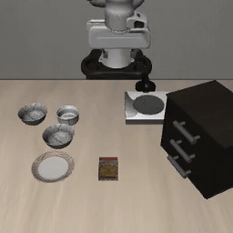

# RFM Simulation on AWS

[](https://github.com/aws-samples/sample-rfm-simulation-on-aws/actions/workflows/ci.yml)
[](LICENSE)
[](https://www.python.org/downloads/)
[](https://docs.aws.amazon.com/cdk/v2/guide/home.html)

Run robot foundation model (RFM) simulation and evaluation on AWS GPU instances with one command. Each target pairs a published policy with its benchmark — Vision-Language-Action (VLA) models such as NVIDIA GR00T, π0.5, OpenVLA-OFT and RLDX-1, world action models such as Cosmos Policy, FastWAM and LingBot-VA, and an LLM-agent policy (ASPIRE, Claude on Amazon Bedrock) — on LIBERO, RoboCasa, SimplerEnv, GR00T-WholeBodyControl and Isaac Lab. `vlasim.py deploy` builds a CDK stack, launches a G5 / G6 / G6e instance, installs the model and simulator at pinned commits, runs the evaluation, writes videos and success rates to S3, emails you, and terminates the instance.

> **Renamed.** This repository was `aws-samples/sample-vla-simulator-on-aws`; GitHub redirects the old URL. Internal identifiers are kept on purpose so existing deployments and stored secrets keep working: the CLI is still `vlasim.py`, the SSM prefix is still `/vla-simulator/*` (for example `/vla-simulator/hf-token`), and the CDK stack file is still `cdk/lib/vla-simulator-stack.ts`.

| π0.5 · LIBERO-Spatial | GR00T N1.6 · RoboCasa GR1 humanoid | GR00T N1.6 · Unitree G1 loco-manipulation |
|---|---|---|
|  |  |  |
| **RLDX-1 · SimplerEnv Google Fractal** | **FastWAM world action model · LIBERO-Spatial** | **OpenArm Lift-Cube · Isaac Lab** |
|  |  |  |

More clips, failure cases and full-quality MP4s: [docs/showcase.md](docs/showcase.md).

## What's inside

- **20 `--vla` targets** (23 stacks counting the four OpenVLA-OFT suites): VLAs, world action models, an LLM-agent policy and two Isaac Lab OpenArm targets ([full list](docs/targets.md)), plus **1 post-run judge target**, `flora-judge` (NVIDIA Flora-Rewarder, **NC**), which scores the videos of a finished run ([judge](docs/targets.md#post-run-judge-flora-rewarder)).
- **One CLI** (`vlasim.py`): `doctor` preflight, `init`, `deploy`, `destroy`, `results`, `gallery` and `judge`. It runs on the Python standard library, so `doctor` works before anything is installed.
- **Reproducible stacks**: model checkpoints, upstream repos and simulator dependencies are pinned per target; each `summary.txt` records a stack fingerprint.
- **AWS CDK v2** stack per target: VPC, retained S3 results bucket, SNS email, IAM role and an AZ / instance-type fallback Lambda for GPU capacity.
- **Results you can compare**: `vlasim results` prints k/n, rate and a 95% Wilson interval for every run in the account ([results](docs/results.md)).

## Quick Start

Prerequisites: an AWS account with credentials configured, On-Demand G and VT vCPU quota for the target instance (`doctor` checks it), Python 3.10+, Node.js and the AWS CLI. A typical run costs about US$0.20 to US$9 of EC2 time ([cost](docs/cost.md)).

```bash
# 0. Get the code
git clone https://github.com/aws-samples/sample-rfm-simulation-on-aws.git
cd sample-rfm-simulation-on-aws

# 1. See what's missing (read-only — safe to run anytime)
python vlasim.py doctor

# 2. One-time setup: installs Python + CDK deps and fills simulator-config.yaml
python vlasim.py init --email you@example.com
#   add --bootstrap to also run `cdk bootstrap` for your account/region

# 3. Deploy (runs doctor as a preflight first, then deploy.py)
python vlasim.py deploy --vla gr00t-g1

# 4. Follow the run, then compare results (read-only)
aws logs tail /gr00t-g1/userdata --follow --region us-east-1
python vlasim.py results --vla gr00t-g1

# 5. Tear down the stack (asks: keep the results + video history, or delete all)
python vlasim.py destroy --vla gr00t-g1
```

- On first deploy, confirm the SNS subscription email so the result notification reaches you.
- Supported regions: `us-east-1`, `us-west-2`, `ap-northeast-1`, `ap-northeast-2`, `eu-central-1`.
- Targets that download gated Hugging Face repos (`gr00t`, `gr00t-g1`, `openarm-isaac`, `cosmos-policy`, `aspire`) need a read token in SSM in each region you deploy to:
  `aws ssm put-parameter --region us-east-1 --name /vla-simulator/hf-token --type SecureString --value <YOUR_HF_TOKEN>`
  (details in [configuration.md](docs/configuration.md#hugging-face-token-gated-models)).
- `deploy` and `destroy` forward every flag to `deploy.py` / `destroy.py` (`--bridge`, `--collect`, `--libero-suite`, `--region`, ...). Run `python vlasim.py deploy --help` for the full list.

## Video history

The completion e-mail links to a password-protected page (Amazon CloudFront) with every video of
every run deployed under your e-mail, grouped by target, newest run first. `python vlasim.py gallery`
prints the URL and password. The `aws s3 sync` download line is still in the e-mail. Opt out with
`--no-gallery` or `deployment.gallery: false`. On destroy you choose to keep the data (default:
results bucket and gallery stay) or `--delete-all`. Details: [docs/gallery.md](docs/gallery.md).

## How it works

```
vlasim.py deploy --vla <target>
  │
  ├─ doctor preflight (quota, bootstrap, credentials, HF token)
  ├─ generate.py          → assets/userdata/<target>.sh   (templates/ + models/<target>.yaml)
  │
  └─ CDK deploy (one stack per target)
       ├─ VPC + SG, IAM role, SNS email, S3 results bucket (RETAIN)
       ├─ AzSelector Lambda  →  EC2 GPU instance (instance-type and AZ fallback)
       └─ UserData: install pinned model + simulator → evaluate → S3 → SNS → terminate
```

Inference runs on the same instance by default. An experimental [bridge mode](docs/bridge-mode.md) forwards inference to a gRPC endpoint you host. Details: [docs/architecture.md](docs/architecture.md).

## Results

Each run writes, per task, rollout videos (`videos/rollout_<task>_success.mp4` / `_failure.mp4`), `summary.txt` (success rate, episode count, condition, stack fingerprint) and logs to the retained bucket `vla-sim-results-<stack name, lowercase>-<region>-<account>` (for example `vla-sim-results-gr00t-demo-us-east-1-<ACCOUNT>`). `vlasim results` reads every such bucket in the account without downloading anything:

```text
$ python vlasim.py results --since 2026-10-19
stack                region          run              suite           condition    k_n    rate  ci95       tasks  not_done
openvla-oft-spatial  ap-northeast-2  2026-10-19-0558  libero_spatial  smoke-knobs  10/10  1.00  0.72-1.00  1      0
```

A task with no `summary.txt` (still running, or the run died) is counted under `not_done`, never as a 0. Download commands, expected success rates per target and the 50-episode same-stack baseline: [docs/results.md](docs/results.md).

`vlasim results --matrix` prints a cross-model leaderboard instead: one row per target, one column per benchmark (LIBERO suites, LIBERO-Plus dimensions, SimplerEnv, RoboCasa, RoboLab, RoboTwin, ...), the latest comparable run per cell with k/n and its Wilson interval, cells marked when their stack fingerprints differ, and an estimated EC2 cost per run and per episode from the run's wall time and a pinned On-Demand price table. `--csv` / `--json` export it and `--write-docs` refreshes the block in [docs/results.md](docs/results.md#cross-model-matrix-leaderboard).

## Supported targets

Instance = first choice in `models/<target>.yaml`; the deploy falls back to other types and AZs when capacity is short. **NC** = non-commercial or research-only weights or tools (see [License](#license)).

| `--vla` | Model | Benchmark | GPU instance |
|---|---|---|---|
| `gr00t` | GR00T N1.7-LIBERO | LIBERO-10 | `g6.12xlarge` |
| `gr00t-bridge` | GR00T N1.7-SimplerEnv-Bridge | SimplerEnv Bridge (WidowX), 4 tasks | `g6.2xlarge` |
| `gr00t-gr1` | GR00T N1.6-3B (**NC**) | RoboCasa GR1 tabletop (Fourier GR1 humanoid) | `g6.12xlarge` |
| `gr00t-g1` | GR00T N1.6-G1 community re-finetune (optional N1.7 adapter) | GR00T-WholeBodyControl loco-manipulation (Unitree G1) | `g6.12xlarge` |
| `pi` | π0.5 (`pi05_libero`) | LIBERO-Spatial / Object | `g5.xlarge` |
| `openvla-oft` | OpenVLA-OFT-7B (per-suite fine-tunes; `--libero-suite spatial\|object\|goal\|10`) | LIBERO-10 (default) / Spatial / Object / Goal | `g6.xlarge` |
| `lap` | LAP-3B | LIBERO-Spatial | `g6.xlarge` |
| `molmoact2` | MolmoAct2 (Ai2, 5B) | LIBERO-Goal | `g6e.2xlarge` |
| `xvla` | X-VLA-0.9B | LIBERO-Spatial | `g6.2xlarge` |
| `smolvla` | SmolVLA-450M | LIBERO-Spatial | `g6.xlarge` |
| `lingbot-va` | LingBot-VA (world action model) | LIBERO-10 | `g6e.2xlarge` |
| `vla-adapter` | VLA-Adapter-Pro | LIBERO-Spatial | `g6.xlarge` |
| `fastwam` | FastWAM (world action model, **NC**) | LIBERO-Spatial | `g6e.2xlarge` |
| `cosmos-policy` | NVIDIA Cosmos Policy (world action model, **NC**) | LIBERO-Spatial | `g6e.xlarge` |
| `aspire` | ASPIRE: Claude on Amazon Bedrock writes the robot program (**NC** tools) | LIBERO-Spatial (LIBERO-Pro fork) | `g6e.2xlarge` |
| `real2sim` | Real2Sim (not a policy): capture → 3DGS → collision meshes → scripted grasp | MuJoCo UR5e + Robotiq 2F-85 on a real tabletop scene (HOPE-Video, **NC** data) | `g5.2xlarge` |
| `rldx` | RLDX-1 (RLWRLD, **NC**) | LIBERO-10 | `g6.xlarge` |
| `rldx-simpler` | RLDX-1 (RLWRLD, **NC**) | SimplerEnv Google-VM (Fractal) | `g6.2xlarge` |
| `rldx-bridge` | RLDX-1 (RLWRLD, **NC**) | SimplerEnv Bridge (WidowX), 4 tasks | `g6.2xlarge` |
| `rldx-gr1` | RLDX-1 (RLWRLD, **NC**) | RoboCasa GR-1 Tabletop | `g6.2xlarge` |
| `rldx-kitchen` | RLDX-1 (RLWRLD, **NC**) | RoboCasa Kitchen (PandaOmron) | `g6.2xlarge` |
| `openarm-lift-act` | Scripted state machine (ACT demo collection) | Isaac Lab Lift-Cube (OpenArm) | `g6.12xlarge` |
| `openarm-isaac` | π0.5 `folding_latest`, experimental pipe proof | Isaac Lab bimanual Reach (OpenArm) | `g6.12xlarge` |
| `robolab-cosmos3` | NVIDIA Cosmos3-Edge-Policy-DROID (world action model; Nano 16B via `model.variant`) | NVIDIA RoboLab (Isaac Lab, DROID Franka), 12-task subset or RoboLab-120 (**NC** assets) | `g6e.2xlarge` |
| `robolab-pi05` | π0.5-DROID (`pi05_droid_jointpos`, openpi) | NVIDIA RoboLab (Isaac Lab, DROID Franka), 12-task subset or RoboLab-120 (**NC** assets) | `g6e.2xlarge` |
| `smolvla-robotwin` | SmolVLA-450M (RoboTwin fine-tune) | RoboTwin 2.0 bimanual (Aloha-AgileX; **NC** CuRobo planner) | `g6.2xlarge` |
| `lingbot-vla2` | LingBot-VLA 2.0 (Robbyant, 6B) | RoboTwin 2.0 bimanual (Aloha-AgileX; **NC** CuRobo planner) | `g6e.2xlarge` |
| `rlinf-oft-libero` | OpenVLA-OFT-7B one-demo SFT, **improved with RL** (RLinf GRPO): eval → train → re-eval | LIBERO-Goal (also 10 / Object) | `g6e.8xlarge` (`smoke`, 1 GPU) / `p5.48xlarge` or `g6e.48xlarge` (`--rl-profile full`, 8 GPU) |

Stack names, robots, per-target notes, deploy and cleanup commands: [docs/targets.md](docs/targets.md). Measured success rates: [docs/results.md](docs/results.md).

**Real2Sim (`real2sim`).** Instead of a policy, this target checks a reconstruction: a multi-view capture of a tabletop is turned into a 3D Gaussian Splatting model (nerfstudio splatfacto), the table and each object are cut out of it as collision meshes (also written as a UsdPhysics `.usda`), and one scripted top-down grasp per object is replayed in MuJoCo with a UR5e + Robotiq 2F-85, against the reconstructed objects, a single scene hull (baseline) and, for the default HOPE-Video scene, the ground-truth meshes. Input: a [HOPE-Video](https://github.com/swtyree/hope-dataset) scene downloaded at run time (**CC BY-NC-SA 4.0, research / non-commercial**) or your own capture zip on S3 (`images/` + a metric nerfstudio `transforms.json`). Output: PSNR / SSIM / LPIPS, per-object fidelity, grasp success per world, videos in the gallery. Measured on HOPE-Video scene 0 (`g5.2xlarge`, `ap-northeast-2`, 2026-10-29): ~12 min instance time (about US$0.30 of EC2), PSNR 24.0, 10 of 10 objects matched (two of them over-split into 2-3 clusters), grasps lifted 8/9 objects with the floating gripper and 4/9 with the UR5e on the reconstruction, 0/9 on the single scene hull. Details: [targets note 12](docs/targets.md#note-12-real2sim).

**RoboLab (`robolab-cosmos3`, `robolab-pi05`).** [NVIDIA RoboLab](https://github.com/NVlabs/RoboLab) is a 120-task Isaac Lab benchmark on the DROID Franka with a public [leaderboard](https://research.nvidia.com/labs/srl/projects/robolab/leaderboard.html). Each target runs RoboLab's server-client setup on one instance: the policy server (cosmos-framework or openpi) and the headless Isaac Sim client side by side, one pair per GPU. The default is a 12-task subset × 5 episodes; `model.variant` in the model yaml switches to Cosmos3-Nano or to the full RoboLab-120 × 10 protocol on `g6e.48xlarge`. Not validated on AWS yet; leaderboard reference and notes: [targets note 13](docs/targets.md#note-14-robolab).

**RoboTwin 2.0 (`smolvla-robotwin`, `lingbot-vla2`).** [RoboTwin 2.0](https://github.com/RoboTwin-Platform/RoboTwin) is a 50-task dual-arm benchmark (SAPIEN, Aloha-AgileX) with a clean (Easy) and a domain-randomized (Hard) setting. Both targets run upstream LeRobot's `lerobot-eval --env.type=robotwin` in-process; the default run is 5 tasks x 5 episodes in the clean setting, and `--robotwin-protocol clean|randomized|full --robotwin-shard K/N` runs the official 49 tasks x 100 episodes in 12-hour shards. `vlasim results` labels the rows `RoboTwin2/<setting>`. Not run on AWS yet. Details: [targets note 14](docs/targets.md#note-15-robotwin-20-smolvla-robotwin-lingbot-vla2).

**RL post-training (`rlinf-oft-libero`).** Evaluate, improve with reinforcement learning, re-evaluate, in one deploy: the target runs [RLinf](https://github.com/RLinf/RLinf) (Apache-2.0, release v0.4, its own Docker image pinned by digest) to evaluate the OpenVLA-OFT one-demonstration SFT checkpoint on LIBERO-Goal, train it with GRPO in the simulator, and evaluate the RL checkpoint with the same protocol. The run writes a `baseline` row and an `rl-grpo-<N>steps` row (`vlasim results`, `--matrix`), `results.json` with both success rates and 95% Wilson intervals, the training curve, the RL checkpoint in S3 (re-evaluate it later with `--rl-eval-run RUN_ID`) and before / after videos in the gallery. `smoke` (default) proves the pipeline on 1 GPU in a few hours; `--rl-profile full` runs the recipe defaults on 8 GPUs (RLinf reports 49.4% -> 94.0% on LIBERO-Goal), capped at 40 h. Not run on AWS yet; time per step is not published, so cost figures are estimates. Details: [targets note 16](docs/targets.md#note-16-rl-post-training-with-rlinf-rlinf-oft-libero), [cost](docs/cost.md#rl-post-training-rlinf-oft-libero).

**Post-run judge (optional).** `python vlasim.py judge --vla <target> [--run RUN_ID]` scores every rollout video of a finished run with NVIDIA Flora-Rewarder (outcome score 1 to 5, success = score >= 4) on a `g7e.2xlarge` and writes `judge.json` / `judge.txt` next to the run; `vlasim results` then shows its agreement with the simulator's success flag. Flora-Rewarder is **non-commercial** (research only). Details: [docs/targets.md](docs/targets.md#post-run-judge-flora-rewarder).

**Robustness sweep (optional, LIBERO-Plus).** `python vlasim.py deploy --vla smolvla --libero-variant plus` (also `openvla-oft --libero-suite spatial`, `pi`, `gr00t`, `xvla`, `fastwam`, `lingbot-va`, `vla-adapter`, `molmoact2`, `rldx`, `lap`) runs the same checkpoint on [LIBERO-Plus](https://github.com/sylvestf/LIBERO-plus) (arXiv 2510.13626), a LIBERO fork with seven perturbation dimensions (camera, robot initial state, language, light, background, sensor noise, object layout). Default: LIBERO-Spatial, 10 seeded variants per dimension, 1 episode each = 70 episodes, about 70-90 min on a `g6.xlarge` for `smolvla` (estimate). Each dimension is one row `LIBERO-Plus/<dimension>` in `vlasim results`; `python vlasim.py results --robustness --vla smolvla` prints the drop against the latest LIBERO run of the same stack. Without the flag nothing changes. The fork's code declares no license (research / evaluation use); it and its 6.4 GB asset pack are downloaded at run time. Details: [targets](docs/targets.md#libero-plus-robustness-sweep), [results](docs/results.md#libero-plus-robustness).

**Reconstructed objects in LIBERO (optional, LIBERO-R2S).** `python vlasim.py deploy --vla openvla-oft --libero-suite object --libero-objects real2sim --real2sim-run s3://<real2sim results bucket>/<RUN_ID>` (also `--vla pi`) takes the objects a `real2sim` run reconstructed from a real capture, puts them into LIBERO in place of the LIBERO objects of the same name (HOPE-Video shows the same grocery objects as LIBERO-Object), checks that they rest where the stock objects rest, and evaluates the same tasks, initial states and seed on the public scene and the swapped scenes (`LIBERO-R2S/public|collision|full` rows; per-object success and Wilson intervals in `<run>/libero-r2s/`). The stack reads only that run's object files. Without the flag nothing changes. Measured on HOPE-Video scene 0 (4 `libero_object` tasks × 10 trials): OpenVLA-OFT public / collision / full = 40/40, 35/40, 38/40; π0.5 = 39/40, 38/40, 29/40 (the untextured orange juice carton drops to 2/10 for π0.5). Details: [targets](docs/targets.md#libero-r2s-reconstructed-objects-in-libero), [results](docs/results.md#libero-r2s-reconstructed-objects).

> **A success rate belongs to the stack that produced it.** Episode count, init states, step cap and action-chunk execution all move the number; compare runs only when they match. See [Expected Results](docs/results.md#expected-results) for the same-stack baseline.

## Documentation

| | |
|---|---|
| [Targets](docs/targets.md) | All targets, notes, GPU instances, deploy / monitor / cleanup |
| [Showcase](docs/showcase.md) | Full rollout gallery |
| [Results](docs/results.md) | Downloading results, `vlasim results`, expected results, baselines |
| [Video history](docs/gallery.md) | Password-protected page with all your run videos, destroy data choice |
| [Configuration](docs/configuration.md) | `doctor`, regions, Hugging Face token, config keys |
| [Architecture](docs/architecture.md) | Deploy flow and project structure |
| [Cost](docs/cost.md) | Instance prices and per-target estimate |
| [Bridge mode](docs/bridge-mode.md) | Experimental: use your own gRPC inference endpoint |
| [Troubleshooting](docs/troubleshooting.md) | Known errors and fixes |
| [Licenses](docs/licenses.md) | Third-party licenses per target, acknowledgments, related projects |

## Contributing

Issues and pull requests are welcome. CI (`.github/workflows/ci.yml`) compiles and tests the CDK app, synthesizes every target and renders every UserData script; run the same steps locally before opening a pull request. See [CONTRIBUTING](CONTRIBUTING.md) and the [Code of Conduct](CODE_OF_CONDUCT.md).

## Security

See [CONTRIBUTING](CONTRIBUTING.md#security-issue-notifications) for more information.

## License

This sample's own code (CDK, generators, templates) is licensed under the MIT-0 License. See the [LICENSE](LICENSE) file.

It orchestrates third-party models, datasets and simulators that are downloaded at **runtime** into your AWS account (not vendored here), each under its own license. **Several are non-commercial or have no stated license:**

- **RLDX-1** weights (`rldx`, `rldx-simpler`, `rldx-bridge`, `rldx-gr1`, `rldx-kitchen`): RLWRLD Model License v1.0, **non-commercial**; research / simulation benchmarking only.
- **GR00T N1.6-3B** (`gr00t-gr1`): NVIDIA One-Way Noncommercial License, **non-commercial**.
- **Cosmos Policy** checkpoint (`cosmos-policy`): NVIDIA One-Way Noncommercial License (NSCLv1), **non-commercial**.
- **ASPIRE** tools (`aspire`): SAM3 (Meta SAM License, gated) and Contact-GraspNet (NVIDIA, **non-commercial**).
- **FastWAM** checkpoint (`fastwam`): no license stated; research / evaluation only.
- **HOPE-Video** dataset (`real2sim` default input): CC BY-NC-SA 4.0, **non-commercial**; downloaded at run time, and the videos / meshes derived from it inherit that license.
- **LIBERO-Plus** (`--libero-variant plus`, the optional robustness sweep): the fork's code repository declares no license; its asset pack is MIT on the Hugging Face dataset card. Research / evaluation use; both are downloaded at run time.
- **RoboLab assets** (`robolab-cosmos3`, `robolab-pi05`): the scenes, objects and robot models bundled with RoboLab are mostly CC BY-NC-SA 4.0, **non-commercial** (RoboLab's code is Apache-2.0; the Cosmos3 weights are OpenMDW-1.1, commercial use allowed).
- **NVIDIA CuRobo** (`smolvla-robotwin`, `lingbot-vla2`: RoboTwin 2.0 builds it as its motion planner): NVIDIA License, **non-commercial**; research / evaluation only.
- **Flora-Rewarder** (`flora-judge`, the optional post-run judge): NVIDIA OneWay Noncommercial License, **non-commercial**; research and development only.

You are responsible for reviewing and complying with each component's license and terms of use. **This is sample code, not production-ready software.** Full table: [docs/licenses.md](docs/licenses.md); attributions: [NOTICE](NOTICE).
