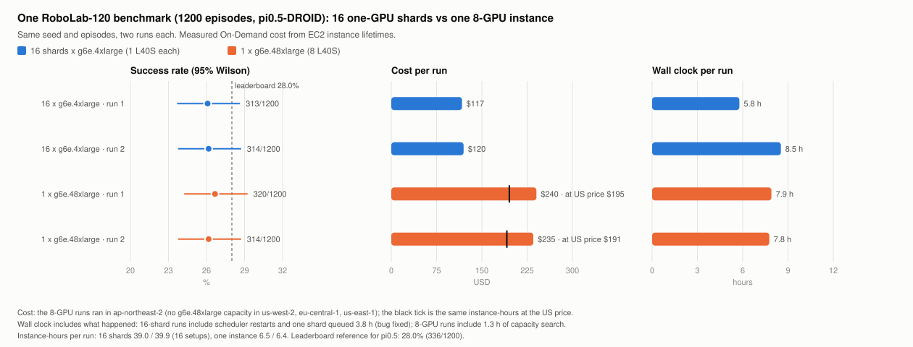

# Splitting one benchmark over many instances (`--shards`)

Back to the [README](../README.md) · [Documentation index](README.md)

`vlasim deploy <target> --shards N` runs one benchmark as N shard stacks. Each shard is its own CDK stack
(own instance, own results bucket), so N shards of the same target run at the same time, in one region or
spread over several. A scheduler on your machine keeps at most M stacks alive, moves a shard to the next region
or instance type when EC2 has no capacity or quota, and merges the shard results into the summary one run writes.

```bash
# RoboLab-120 (120 tasks x 10 episodes) on 16 one-GPU stacks, two independent runs, over three regions
python vlasim.py deploy robolab-pi05 --robolab-variant full-shard --shards 16 --runs 2 \
    --regions us-east-1,us-west-2,eu-central-1 --instance-types g6e.2xlarge,g6e.4xlarge \
    --max-instances 16 --auto-destroy --dry-run      # prints every deploy command; drop --dry-run to run
```

## Flags

| Flag | Meaning |
|---|---|
| `--shards N` | Number of shards (1..256). |
| `--runs R` | Independent runs of the whole benchmark, each split into N shards: R x N stacks in one go (`auto` = the target's `--repeats auto`, 2 for RoboLab). Default 1. |
| `--regions a,b,c` | Regions to use (default: `simulator-config.yaml`). |
| `--instance-types t1,t2` | Instance types to try in order (default: the target's / variant's `instance.preferred`). |
| `--max-instances M` | At most M shard stacks alive at once (default N x R). |
| `--spot` | Launch Spot first (On-Demand inside the same stack when Spot has no capacity). An interruption re-runs only that shard; after two interruptions it runs On-Demand. |
| `--auto-destroy` | Delete each shard stack as soon as its run is done (the results bucket is kept). |
| `--launch-batch B` | At most B deploy processes at a time (default 4); each runs a local CDK synth + deploy, and 32 at once exhausted a 16 GB machine. |
| `--max-usd X` | Stop new launches once the spend (instance-hours x price, running ones included) reaches X. |
| `--robolab-variant V` | RoboLab: `model.variant` for every shard (`full-shard` / `edge-full-shard` = RoboLab-120 on one L40S per shard). |
| `--run-dir D` | State and results directory (default `fanout/<target>-<variant>-<N>x<R>`). |
| `--dry-run` | Print the plan, every deploy command with its region and instance type, and render + `bash -n` each shard's user data. No AWS call. |
| `--task-set NAME` / `--tasks-file PATH` | Split that task list instead of the model's `tasks:` (list-based targets); every shard file carries the set's model overrides. |

`--email` and `--seed` are passed to every shard; other unknown flags are passed through to `deploy.py`, except
the flags the scheduler sets per shard (`--region`, `--shard`, `--repeats`, `--tasks-file`, `--instance-types`,
`--spot`, ...), which are rejected.
The video history gallery is off for shard stacks unless `--gallery` is given (N parallel deploys would race on
creating it).

## How the benchmark is split

Shard K of N (1-based) takes every N-th task unit starting at unit K, `units[K-1::N]` (the
[RoboTwin](targets.md#note-15-robotwin-20-smolvla-robotwin-lingbot-vla2) `--robotwin-shard K/N` rule). The
shards are disjoint, their union is the full list, and the same list and N always give the same shards.

| Target | Unit | Order |
|---|---|---|
| `robolab-*` | one task class (all its episodes) | the protocol's `tasks:`; for the full protocol (`tasks: []`) the 120 names in [`assets/robolab/robolab-120-tasks.txt`](../assets/robolab/robolab-120-tasks.txt), code-point sorted, pinned to `model.robolab_commit` |
| `smolvla-robotwin`, `lingbot-vla2` | one (setting, task) pair | the RoboTwin plan; shard K is `--robotwin-shard K/N` |
| targets whose `tasks:` is a list of entries (LIBERO families, SimplerEnv, ...) | one task id of an entry, or the entry when it has no `task_ids` | the yaml (or `--task-set`) order; each shard gets a tasks file (the `vlasim bench` `--tasks-file` mechanism) |

Targets without an enumerable task list (for example `openvla-oft`, whose `tasks:` is keyed by suite) stop
with an error. If the RoboLab commit moves, regenerate the task list (command in the file header); the split
refuses a list that does not match the pinned commit.

## Stacks, buckets and results

- Stack: `<base stack>-s03of16`, with `--runs`: `<base stack>-r2-s03of16` (`deploy.py --shard 3/16
  [--shard-run 2]`, CDK context `shard`). Two stacks of the same target in one region need no hand patch.
- User data: `assets/userdata/<target>-<token>.sh`; CDK output dir `cdk.out-<target>-<token>`.
- Results bucket: `<prefix>-<base>-<token>-<region>-<account>`, where `<base>` is the stack name without
  `-Demo`, cut so the name fits 63 characters (`shards.bucket_name`, `resultsBucketName` in the CDK stack).
- A RoboLab shard writes its `summary.txt` with `fanout_shard: K/N` and `task_ids: [...]` (positions in the
  full task list), so `vlasim results --matrix` can pool the shards of one run too.
- Instance tags `VlasimShard` and `VlasimFanout` (the run directory name).

When every shard is done, the scheduler downloads each shard's `summary.txt`, `robolab_results.json` and raw
episode files, and writes per run `<run dir>/merged/run-<r>/`:

- RoboLab: `summary.txt` + `robolab_results.json`, produced by
  [`assets/robolab/robolab_report.py`](../assets/robolab/robolab_report.py) (the script the instance runs) over
  the raw episodes of all shards, so the numbers equal those of one instance running every task
  (`tests/test_shards.py` checks this).
- Other targets: every shard task as `task-<i>/summary.txt` and `summary.json` with k/n pooled per suite.

`<run dir>/fanout-result.json` has one row per run: k/n, success rate, Wilson interval, the shards and their
attempts, and the cost below.

## Scheduling, failures, resume

Each shard has an ordered candidate list: every `--regions` entry for the first `--instance-types` entry, then
the next type. The first region rotates with the shard index, so the shards of one type spread over the regions.

| Event | What the scheduler does |
|---|---|
| `InsufficientInstanceCapacity`, `No capacity available for any instance type`, Spot capacity errors | delete the failed stack, move the shard to its next candidate, cap that (region, type) at the number of shards still running there |
| `VcpuLimitExceeded` and other limit errors | the same (quota) |
| every candidate failed on capacity | wait 20 min and start over; after 3 rounds the shard is `failed` |
| any other deploy failure | retry once on the next candidate, then `failed` |
| Spot interruption (`Server.SpotInstanceTermination`) | stop that deploy, delete its stack, re-queue only that shard |

A unit goes `queued -> launching -> running -> collecting -> done`. The launch intent is saved before the deploy
process is spawned and its pid right after (the process also writes a receipt file); on resume an attempt left
in `launching` is matched against the receipt and CloudFormation and is never launched a second time. A failed,
interrupted or auto-destroyed stack goes through `cleanup`: it keeps its `--max-instances` slot, and no
replacement is launched, until CloudFormation confirms the deletion (retried every step). `collecting` means the
deploy finished but the results are not downloaded and validated yet; it is retried every step and on resume, and
`--auto-destroy` deletes a stack only after its results were confirmed.

State is written to `<run dir>/fanout-state.json` after every step (every 120 s, `--poll`). The deploys run
detached: Ctrl-C or a lost terminal does not stop them, and running the same command again resumes from the
state file. The state carries a fingerprint of the effective task units per shard, episode protocol, seed,
variant and benchmark-affecting flags; a resume with a different fingerprint is refused. Operational settings
(regions, instance types, `--max-instances`, `--spot`, `--auto-destroy`, `--max-usd`, e-mail) may change.
A file named `STOP` in the run dir stops new launches; running shards finish. `--max-usd` does the same when the
spend reaches the cap.

## Cost per run

Cost is measured, not estimated: for every instance a shard launched (retries and interrupted Spot attempts
included; each instance id belongs to exactly one attempt and is counted once), instance-hours = EC2
`LaunchTime` to the termination time in `StateTransitionReason`, times the On-Demand price of that type and
region (`leaderboard.PRICES`, AWS Price List API, date in the file) or, for Spot, the EC2 Spot price history
integrated over the instance's lifetime (all pages, the price in effect at launch, each change weighted by how
long it applied). `fanout-result.json`, the merged
`robolab_results.json` / `summary.json` and the merged RoboLab `summary.txt` (`cost_usd`, `instance_hours`) carry it per run, with
`usd_per_episode` and the wall clock from the first deploy to the last shard done. Stack create / delete, EBS,
NAT gateway and data transfer are not included.

## Measured: RoboLab-120, 16 shards vs 1 instance

`robolab-pi05` (pi0.5-DROID), full RoboLab-120 protocol (120 tasks x 10 episodes), two runs per layout,
measured 2026-11-07/08. **16 shards**: `--robolab-variant full-shard --shards 16 --runs 2`, one L40S per shard
(`g6e.4xlarge`; `g6e.2xlarge` had no capacity in any of the three regions, so the scheduler moved every shard to
the next type), `us-west-2`, `us-east-1`, `eu-central-1`. **1 instance**: `--robolab-variant full --shards 1 --runs 2`
on `g6e.48xlarge` (8 x L40S, one server-client pair per GPU); no `g6e.48xlarge` capacity in the three US / EU
regions for 1.3 h, so both runs ran in `ap-northeast-2`.



| Layout | Run | Success | Rate (Wilson 95%) | Instance-hours | Cost (USD) | Wall clock |
|---|---|---|---|---|---|---|
| 16 x `g6e.4xlarge` | 1 | 313/1200 | 26.1% (23.7-28.6%) | 39.0 | 117.11 | 5.8 h |
| 16 x `g6e.4xlarge` | 2 | 314/1200 | 26.2% (23.8-28.7%) | 39.9 | 119.81 | 8.5 h |
| 1 x `g6e.48xlarge` | 1 | 320/1200 | 26.7% (24.2-29.2%) | 6.49 | 240.32 (Seoul) / ~195.5 (US price) | 7.9 h |
| 1 x `g6e.48xlarge` | 2 | 314/1200 | 26.2% (23.8-28.7%) | 6.35 | 235.26 (Seoul) / ~191.3 (US price) | 7.8 h |

Cost = the measured instance-hours x On-Demand price ([Cost per run](#cost-per-run)); "US price" is the same
hours at the `us-west-2` `g6e.48xlarge` price, for a like-for-like comparison with the US / EU shards. Leaderboard
reference for pi0.5: 28.0% (336/1200).

- **Same result.** All four runs fall between 26.1% and 26.7%, each inside the others' Wilson interval: splitting
  the benchmark into 16 stacks does not change the score.
- **About half the cost.** 117-120 USD per run with 16 shards against ~191-196 USD for one `g6e.48xlarge` at the
  same regional price (235-240 USD at the Seoul price paid). Sixteen `g6e.4xlarge` cost less per GPU-hour than
  one `g6e.48xlarge`, and a shard stops paying when its own tasks are done instead of waiting for the slowest GPU.
- **Wall clock is not a clean comparison.** Both layouts include incidents: the 16-shard runs include two
  scheduler restarts (a lost scheduler machine) and, in run 2, one shard left queued for ~3.8 h by a scheduler
  bug (fixed); the 1-instance wall clock includes 1.3 h of capacity search before Seoul was added. A clean shard
  took ~2.5 h on `g6e.4xlarge` (setup included), so with capacity in place a 16-shard run finishes in about
  2.5-3 h against ~6.4 h of instance time for the 8-GPU instance.

The figure is drawn from [`data/shards-robolab120.json`](data/shards-robolab120.json) by
`python3 tools/shards-figure/plot.py render`.

## Limits

- Every shard stack creates its own SNS topic: the notification address gets one subscription confirmation and
  one completion e-mail per shard.
- A shard has the same 12 h CloudFormation WaitCondition limit as any deploy; choose N so one shard fits.
- RoboLab assets are mostly CC BY-NC-SA 4.0 (non-commercial); see [targets note 14](targets.md#note-14-robolab).
