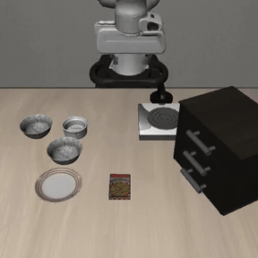
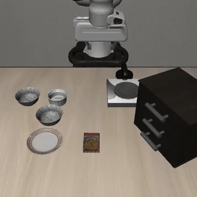
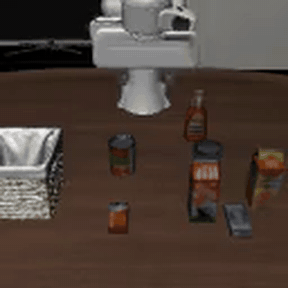
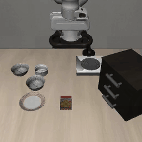
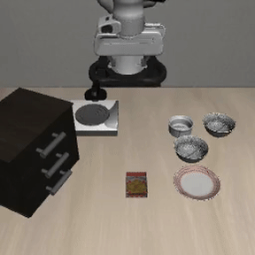
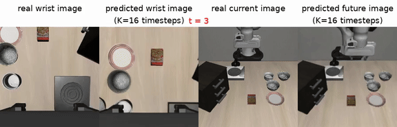
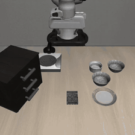

# Showcase: rollouts

Back to the [README](../README.md) · [Documentation index](README.md) · Targets: [targets.md](targets.md) · Numbers: [results.md](results.md)

Sample rollouts captured directly from `deploy.py` runs and synced from each stack's S3 results bucket. GIFs are downsampled previews (288 px, 10 fps, ≤8 s); click-through to the full-quality MP4 in [`docs/showcase/`](showcase/) for the original frame rate and resolution.

## `pi` — π0.5 on LIBERO (Franka Panda 7-DOF)

`libero_spatial = 0.99` (10 tasks × 10 episodes), `libero_object = 0.96` (10 tasks × 5 episodes) — `g5.xlarge`, validated 2026-04-22.

| LIBERO-Spatial — pick black bowl between plate and ramekin | LIBERO-Object — pick milk and place in basket |
|---|---|
|  |  |
| MP4: [`pi/libero-spatial-between-plate-ramekin-success.mp4`](showcase/pi/libero-spatial-between-plate-ramekin-success.mp4) | MP4: [`pi/libero-object-milk-success.mp4`](showcase/pi/libero-object-milk-success.mp4) |

## `openvla-oft` — OpenVLA-OFT on LIBERO-10 long-horizon

Each task is a two-stage instruction. Long-horizon means the policy must complete one sub-goal, recognise it, then proceed to the next. Verb diversity below shows the same checkpoint following structurally different instructions. `g6.xlarge`, validated 2026-05-04. Carries a `mujoco==3.3.1` pin (FIX 14, `sim_protect_pins`) and a `tensorflow-metadata==1.17.3` pin (FIX 15): mujoco 3.10.0 shipped 2026-06-22, after this target validated, and its `mj_fullM` signature change breaks robosuite's call site mid-eval, while an unbounded `tensorflow-metadata` resolves to a release whose code needs a protobuf that `tensorflow==2.15` forbids (see [#4](https://github.com/aws-samples/sample-rfm-simulation-on-aws/issues/4)).

| `put both the alphabet soup and the tomato sauce in the basket` | `turn on the stove and put the moka pot on it` |
|---|---|
|  |  |
| MP4: [`openvla-oft/libero-10-soup-and-sauce-success.mp4`](showcase/openvla-oft/libero-10-soup-and-sauce-success.mp4) | MP4: [`openvla-oft/libero-10-stove-moka-pot-success.mp4`](showcase/openvla-oft/libero-10-stove-moka-pot-success.mp4) |

| `put the white mug on the left plate and the yellow mug on the right` | `pick up the book and place it in the back compartment` |
|---|---|
|  |  |
| MP4: [`openvla-oft/libero-10-mug-left-yellow-right-success.mp4`](showcase/openvla-oft/libero-10-mug-left-yellow-right-success.mp4) | MP4: [`openvla-oft/libero-10-book-compartment-success.mp4`](showcase/openvla-oft/libero-10-book-compartment-success.mp4) |

## `lap` — LAP-3B on LIBERO-Spatial

`libero_spatial = 0.98` (10 tasks × 5 trials, `g6.xlarge`, validated 2026-05-17). Same scene as `pi` above, different policy — useful for side-by-side comparison. The `cookie_box` task is the one consistent failure mode (paper Table III range 85–95% leaves 1–2 tasks expected to miss).

| Success — `pick up the black bowl between the plate and the ramekin` | Failure — `pick up the black bowl on the cookie box` |
|---|---|
|  |  |
| MP4: [`lap/libero-spatial-between-plate-ramekin-success.mp4`](showcase/lap/libero-spatial-between-plate-ramekin-success.mp4) | MP4: [`lap/libero-spatial-cookie-box-failure.mp4`](showcase/lap/libero-spatial-cookie-box-failure.mp4) |

## `molmoact2` — MolmoAct2 (Ai2) on LIBERO-Goal (Franka Panda 7-DOF)

MolmoAct2 is Ai2's open **Action Reasoning Model** (5B; a Molmo2-ER VLM backbone + a flow-matching continuous-action expert), **Apache-2.0** weights and code. Unlike the LeRobot-native models above, it is served from the `allenai/lerobot` fork (`molmoact2-policy` branch, not yet merged upstream), pinned at `@a4f15bf3`; the public `allenai/MolmoAct2-LIBERO` checkpoint is run **in-process** on the sim GPU. `libero_goal = 1.000` (2 tasks × 5 episodes = 10/10), `g6e.2xlarge` (L40S 48 GB), **float32** + `norm_tag=libero`, continuous action mode, validated 2026-06-28. Both clips below are the same `put the bowl on the stove` task from different LIBERO initial states (the only task rendered locally this run); the consistent place-on-burner across init states is what 1.000 looks like here.

| Success — `put the bowl on the stove` (init state A) | Success — `put the bowl on the stove` (init state B) |
|---|---|
|  |  |
| MP4: [`molmoact2/libero-goal-bowl-on-stove-success.mp4`](showcase/molmoact2/libero-goal-bowl-on-stove-success.mp4) | MP4: [`molmoact2/libero-goal-bowl-on-stove-2-success.mp4`](showcase/molmoact2/libero-goal-bowl-on-stove-2-success.mp4) |

## `rldx` — RLDX-1 (RLWRLD) on LIBERO-10 long-horizon (Franka Panda 7-DOF)

RLDX-1 is an open VLA from RLWRLD (MSAT action head on a Qwen3-VL-8B backbone; the RLDX-1 paper reports a 97.8% LIBERO average). Served eager via a ZeroMQ policy server + sim client (two venvs), `g6.xlarge` L4 sm_89, validated 2026-06-20. Two LIBERO-10 **long-horizon** tasks (distinct scenes from the `pi` / `lap` spatial clips above): `STUDY_SCENE1` book→caddy `success_rate = 1.0` (5/5); `KITCHEN_SCENE6` mug→microwave+close (articulated, two-stage) `success_rate = 0.8` (4/5). Weights are **non-commercial** (RLWRLD Model License v1.0) — sim benchmarking only. Carries a `mujoco==3.3.1` pin (FIX 11, `sim_protect_pins`): mujoco 3.10.0 shipped 2026-06-22 — two days after this target validated — and its `mj_fullM` signature change breaks robosuite's call site, so the LIBERO dependency chain must hold mujoco below 3.10 (see [#4](https://github.com/aws-samples/sample-rfm-simulation-on-aws/issues/4)).

| Success — `STUDY_SCENE1: pick up the book and place it in the back compartment of the caddy` (SR 1.0, 5/5) | Success — `KITCHEN_SCENE6: put the yellow and white mug in the microwave and close it` (SR 0.8, 4/5) |
|---|---|
|  |  |
| MP4: [`rldx/libero10-study-book-caddy-success.mp4`](showcase/rldx/libero10-study-book-caddy-success.mp4) | MP4: [`rldx/libero10-kitchen-mug-microwave-success.mp4`](showcase/rldx/libero10-kitchen-mug-microwave-success.mp4) |
| _Tight, consistent: all 5 episodes complete in 20–23 env-steps._ | Failure (1/5) — same task, hits the 90-step cap without closing: |
| |  |
| | MP4: [`rldx/libero10-kitchen-mug-microwave-failure.mp4`](showcase/rldx/libero10-kitchen-mug-microwave-failure.mp4) (clip is 2× speed) |

> **Reading the success rate — "success" is a binary goal flag, not a quality score.** LIBERO marks an episode `success` the moment its BDDL goal predicate is satisfied; it says nothing about how cleanly or how close to the failure boundary the policy got there. That distinction matters on long-horizon tasks:
> - `STUDY_SCENE1` (SR 1.0) is genuinely robust — every episode finishes in 20–23 env-steps with margin to spare.
> - `KITCHEN_SCENE6` (SR 0.8) is **marginal even when it succeeds**: successful episodes range from a clean 32 steps to a labored 47 steps, while the failure runs the full 90-step cap (a *timeout*, not a hard error). The scene also contains a second (grey) mug as a distractor next to the yellow/white target. A near-cap success is one perturbation away from a timeout — so treat 0.8 here as "works, but not yet deployment-margin," not as a 4-in-5 guarantee of reliable execution.
>
> Takeaway for demos: pair the SR number with the **step-count spread** (in `simulation_results.csv`) and watch the failure clip — a high SR with episodes clustered near the step cap is a weaker result than the same SR with short, consistent runs.

## `rldx-simpler` — RLDX-1 (RLWRLD) on SimplerEnv Google Fractal (real-robot embodiment)

Same RLDX-1 checkpoint family as `rldx` above, but evaluated on **SimplerEnv** (ManiSkill2_real2sim + SAPIEN) with the Google Robot **`OXE_FRACTAL`** embodiment — the one target here that exercises a *real-robot* Open X-Embodiment embodiment rather than a simulated Panda/humanoid. Served eager via the same ZeroMQ policy server + sim client (two venvs), `g6.2xlarge` L4 sm_89, validated 2026-06-24 via a full `deploy.py` 1-shot smoke. Two Google-VM tasks: `google_robot_pick_coke_can` `success_rate = 1.0` (5/5) and `google_robot_move_near` `success_rate = 1.0` (5/5). Weights are **non-commercial** (RLWRLD Model License v1.0) — sim benchmarking only.

> **Clips are shown at 0.25× (slowed 4×)**, with the playback rate overlaid bottom-left. These are *atomic* Google-robot tasks — each episode runs only 10–25 sim steps, so at native speed it finishes in ~1 second. The 4× slowdown makes the motion legible and paces these clips with the long-horizon GR-1 clips below (up to 720 steps). No frames are dropped or trimmed; only the timestamps are stretched.

| Success — `google_robot_pick_coke_can` (SR 1.0, 5/5) | Success — `google_robot_move_near` (SR 1.0, 5/5) |
|---|---|
|  |  |
| MP4: [`rldx-simpler/simpler-google-pick-coke-can-success.mp4`](showcase/rldx-simpler/simpler-google-pick-coke-can-success.mp4) | MP4: [`rldx-simpler/simpler-google-move-near-success.mp4`](showcase/rldx-simpler/simpler-google-move-near-success.mp4) |
| _Tight and consistent: episodes complete in 10–25 env-steps (shown at 0.25×)._ | _Real-robot Fractal embodiment — distinct from every LIBERO/RoboCasa clip above (shown at 0.25×)._ |

## `rldx-gr1` — RLDX-1 (RLWRLD) on RoboCasa GR-1 Tabletop (bimanual humanoid + waist)

Same RLDX-1 family as `rldx`/`rldx-simpler`, but on **RoboCasa GR-1 Tabletop** with RLWRLD's own `RLDX-1-FT-GR1` checkpoint — the only target here on a **bimanual humanoid with a waist DOF** (`GR1ArmsAndWaistFourierHands`: two 7-DOF arms + Fourier dexterous hands + waist), distinct from every single-arm LIBERO/SimplerEnv clip. Each clip is dual-view (left ego / right third-person); the policy controls both hands and the waist to manipulate **articulated** scene objects (a drawer, a microwave door). Served eager via the same ZeroMQ policy server + sim client (two venvs, MuJoCo/robosuite headless EGL — no Vulkan), `g5.2xlarge` A10G 24 GB, validated 2026-06-25 via a full `deploy.py` 1-shot smoke. Two articulated tasks at n=5: `PnPCupToDrawerClose` `success_rate = 0.80` (4/5) and `PnPMilkToMicrowaveClose` `success_rate = 0.20` (1/5) — the combined 5/10 is consistent with the paper's 58.7% 24-task average. Weights are **non-commercial** (RLWRLD Model License v1.0) — sim benchmarking only.

| Success — `PnPCupToDrawerClose` (SR 0.80, 4/5) | Success — `PnPMilkToMicrowaveClose` (SR 0.20, 1/5) |
|---|---|
|  |  |
| MP4: [`rldx-gr1/gr1-cup-drawer-success.mp4`](showcase/rldx-gr1/gr1-cup-drawer-success.mp4) | MP4: [`rldx-gr1/gr1-milk-microwave-success.mp4`](showcase/rldx-gr1/gr1-milk-microwave-success.mp4) |
| _Clean bimanual pick-place-close in 19 env-steps; the harder of the two tasks the policy reliably solves._ | _The rare success on the hard task (24 steps) — most runs time out (see failure clip)._ |

| Failure — `PnPMilkToMicrowaveClose` (4/5 of this task, step-cap timeout) |
|---|
|  |
| MP4: [`rldx-gr1/gr1-milk-microwave-failure.mp4`](showcase/rldx-gr1/gr1-milk-microwave-failure.mp4) (clip is 2× speed) |
| _The dominant outcome on the microwave task: the run hits the 45-step cap (a *timeout*, not a hard error) without satisfying the goal predicate. SR 0.20 here means "rarely solved," not "1-in-5 reliable" — pair the number with the per-episode step counts in `simulation_results.csv`._ |

## `rldx-kitchen` — RLDX-1 (RLWRLD) on RoboCasa Kitchen (PandaOmron mobile manipulator)

Same RLDX-1 family again, but on the **RoboCasa Kitchen** 24-task benchmark with RLWRLD's own `RLDX-1-FT-ROBOCASA` checkpoint — a **single-arm mobile manipulator** (`PandaOmron`: a Franka Panda arm on an Omron LD mobile base) operating **articulated kitchen fixtures** (cabinet doors, drawers) inside full procedurally-generated kitchen scenes, distinct from the GR-1 humanoid and every LIBERO/SimplerEnv clip. Each clip is a three-camera strip — the two external views (left / right) plus the wrist camera, exactly the views the policy consumes. Served eager via the same ZeroMQ policy server + sim client (two venvs, MuJoCo/robosuite headless EGL — no Vulkan), `g6.2xlarge` L4 24 GB, validated 2026-06-26 via a full `deploy.py` 1-shot smoke. Two articulated tasks at n=5: `OpenSingleDoor` `success_rate = 0.80` (4/5) and `OpenDrawer` `success_rate = 0.80` (4/5) — consistent with the paper's 70.6% 24-task average. Weights are **non-commercial** (RLWRLD Model License v1.0) — sim benchmarking only.

> RoboCasa Kitchen's env emits each of the three cameras at two resolutions (a 256-px policy input + a raw 512-px copy), and the stock video recorder stacks **all** of them — so the unfiltered MP4 is a six-panel strip showing every camera twice. A target-gated runtime fix (FIX 10) narrows the recorder to the 256-px views, giving the clean three-panel video below. The clips here are post-processed to that same three-panel form; FIX 10 makes it the default on the next deploy.

| Success — `OpenSingleDoor` (SR 0.80, 4/5) | Success — `OpenDrawer` (SR 0.80, 4/5) |
|---|---|
|  |  |
| MP4: [`rldx-kitchen/kitchen-open-single-door-success.mp4`](showcase/rldx-kitchen/kitchen-open-single-door-success.mp4) | MP4: [`rldx-kitchen/kitchen-open-drawer-success.mp4`](showcase/rldx-kitchen/kitchen-open-drawer-success.mp4) |
| _Three-camera strip (left / right / wrist); the arm reaches the cabinet handle and swings the door open in 18 env-steps._ | _Distinct mobile-manipulator embodiment — the PandaOmron base + arm pulls the drawer open in 16 env-steps._ |

| Failure — `OpenSingleDoor` (1/5 of this task, step-cap timeout) |
|---|
|  |
| MP4: [`rldx-kitchen/kitchen-open-single-door-failure.mp4`](showcase/rldx-kitchen/kitchen-open-single-door-failure.mp4) (clip is 2× speed) |
| _The one miss on the door task: the run hits the 45-step cap (a *timeout*, not a hard error) without latching the handle. SR 0.80 here means "usually solved" — pair the number with the per-episode step counts in `simulation_results.csv`._ |

## `xvla` · `smolvla` · `lingbot-va` · `vla-adapter` · `fastwam` · `cosmos-policy` · `aspire` — newer VLA / world action models on LIBERO (Franka Panda 7-DOF)

Three upstream-LeRobot policies run through the shared `lerobot-libero` template, plus VLA-Adapter-Pro on its own OFT-style template (validated 2026-10-14) and FastWAM (2026-10-15, research-only weights — see [targets note 8](targets.md#note-8-fastwam)) and Cosmos Policy (2026-10-17, its own Docker image, research-only weights — see [targets note 9](targets.md#note-9-cosmos-policy)), all in ap-northeast-2. Each clip strings together the rendered episodes of the pipe-proof run (the VLA-Adapter preview is sped up ~4× to fit all 10 tasks; LingBot-VA renders at 128 px).

| `xvla` — X-VLA-0.9B · libero_spatial (2 tasks × 5 ep) **0.90** · `g6.2xlarge` | `smolvla` — SmolVLA-450M · libero_spatial (2 tasks × 5 ep) **0.80** · `g6.xlarge` |
|---|---|
|  |  |
| MP4: [`xvla/libero-spatial-5ep.mp4`](showcase/xvla/libero-spatial-5ep.mp4) | MP4: [`smolvla/libero-spatial-5ep.mp4`](showcase/smolvla/libero-spatial-5ep.mp4) |

| `lingbot-va` — LingBot-VA (world action model) · libero_10 (2 tasks × 3 ep) **1.00** · `g6e.2xlarge` | `vla-adapter` — VLA-Adapter-Pro · libero_spatial (10 tasks × 1 trial) **1.00** · `g6.xlarge` |
|---|---|
|  |  |
| MP4: [`lingbot-va/libero-long-3ep.mp4`](showcase/lingbot-va/libero-long-3ep.mp4) | MP4: [`vla-adapter/libero-spatial-10ep.mp4`](showcase/vla-adapter/libero-spatial-10ep.mp4) |

| `fastwam` — FastWAM (world action model, bf16) · libero_spatial (2 tasks × 5 ep) **0.90** · `g6e.2xlarge` |
|---|
|  |
| MP4: [`fastwam/libero-spatial-5ep.mp4`](showcase/fastwam/libero-spatial-5ep.mp4) |

| `cosmos-policy` — Cosmos Policy (world action model) · libero_spatial (10 tasks × 1 trial) **1.00** · `g6e.xlarge` | `cosmos-policy` — what the world model predicts: real vs predicted wrist / third-person frames 16 steps ahead |
|---|---|
|  |  |
| MP4: [`cosmos-policy/libero-spatial-10ep.mp4`](showcase/cosmos-policy/libero-spatial-10ep.mp4) | MP4: [`cosmos-policy/libero-spatial-future-frames-5ep.mp4`](showcase/cosmos-policy/libero-spatial-future-frames-5ep.mp4) |

| `aspire` — ASPIRE (Claude on Bedrock writes the program) · libero_spatial (2 tasks × 5 ep) **1.00** · `g6e.2xlarge` |
|---|
|  |
| MP4: [`aspire/libero-spatial-10ep.mp4`](showcase/aspire/libero-spatial-10ep.mp4) |

**ASPIRE vs the trained models, same 10 episodes** (LIBERO-Spatial tasks 0-1, saved init states 0-4, ap-northeast-2, 2026-10):

| Target | What runs at test time | Task-specific training | Success (10 ep) | Per-task setup cost |
|---|---|---|---|---|
| `xvla` | X-VLA-0.9B policy | LIBERO fine-tune (checkpoint) | 0.90 | none (download) |
| `smolvla` | SmolVLA-450M policy | LIBERO fine-tune (checkpoint) | 0.80 | none (download) |
| `fastwam` | FastWAM world action model | LIBERO fine-tune (checkpoint) | 0.90 | none (download) |
| `aspire` | a Python program written by Claude (SAM3 segmentation + depth → grasp → IK) | **none** — the agent explored dev seeds 51-65 only | **1.00** | agent 8-18 min, 31-69 turns, **US$0.91-2.30 Bedrock** per task (US$3.21 for both) |

_Read with care: n = 10 on two easy tasks, so 0.90 vs 1.00 is one episode. The point is the trade-off, not the ranking — ASPIRE needs no robot data or fine-tune, but pays an agent session per new task and leans on gated / non-commercial perception tools ([targets note 10](targets.md#note-10-aspire)); the trained policies are a fixed download that generalises across the suite. `vla-adapter` and `cosmos-policy` (1.00 each) were scored on 10 tasks × 1 trial, a different episode set, so they are not in this table._

## `gr00t-gr1` — GR00T N1.6 on RoboCasa GR1 humanoid (22-DOF)

The GR1 humanoid is a different embodiment from Franka Panda — two arms, waist, Fourier dexterous hands. `PosttrainPnPNovelFromPlateToBowlSplitA` is in distribution for the post-trained N1.6 (~80% success), while `PnPCanToDrawerClose` is **not supported** by the pre-trained checkpoint and consistently fails — included to make the embodiment-coverage limitation visible. `g6.12xlarge`, validated 2026-04-10.

| Success — `PosttrainPnPNovelFromPlateToBowlSplitA` (in-distribution) | Failure — `PnPCanToDrawerClose` (not supported by N1.6) |
|---|---|
|  |  |
| MP4: [`gr00t-gr1/posttrain-pnp-plate-to-bowl-success.mp4`](showcase/gr00t-gr1/posttrain-pnp-plate-to-bowl-success.mp4) | MP4: [`gr00t-gr1/pnp-can-to-drawer-failure.mp4`](showcase/gr00t-gr1/pnp-can-to-drawer-failure.mp4) |

## `gr00t-g1` — GR00T N1.6 on Unitree G1 (whole-body loco-manipulation)

This is **whole-body loco-manipulation**, not tabletop: the dual-view clips show the G1 humanoid grasp the apple, then *walk left* on its own legs (GR00T-WholeBodyControl Balance/Walk ONNX policies) to a second table and place it on the plate — task `pick up the apple, walk left and place the apple on the plate` (`LMPnPAppleToPlateDC_G1_gear_wbc`). The left pane is the ego/close view, the right is third-person.

> **Checkpoint note.** NVIDIA published no N1.7 Unitree G1 checkpoint, and the only public N1.6 G1 checkpoint (`nvidia/GR00T-N1.6-G1-PnPAppleToPlate`) does **not** reproduce its stated success rate under the released evaluation command — it scores 0/10, matching multiple open Isaac-GR00T issues with no upstream fix. The only public artifact that reproduces the task is a community re-finetune, [`cloudwalk-research/GR00T-N1.6-G1-PnPAppleToPlate`](https://huggingface.co/cloudwalk-research/GR00T-N1.6-G1-PnPAppleToPlate) (same GR00T N1.6 architecture, drop-in compatible), which scores **`success_rate = 0.3` (3/10)** here. `g6.12xlarge`, `n_envs=1`, validated 2026-06-15.

| Success — apple picked, walked left, placed on plate | Failure — grasp + walk OK, placement misses |
|---|---|
|  |  |
| MP4: [`gr00t-g1/loco-manip-apple-to-plate-success.mp4`](showcase/gr00t-g1/loco-manip-apple-to-plate-success.mp4) | MP4: [`gr00t-g1/loco-manip-apple-to-plate-failure.mp4`](showcase/gr00t-g1/loco-manip-apple-to-plate-failure.mp4) |

### Optional: run a fine-tuned GR00T **N1.7** Unitree-G1 adapter on the same sim

The same `gr00t-g1` target can serve a fine-tuned **GR00T N1.7** Unitree-G1 adapter instead of the N1.6 demo checkpoint. NVIDIA published no N1.7 G1 checkpoint (`UNITREE_G1` is a post-train tag — the base gives ~0%), so this is a fine-tuned adapter. The default in [`models/gr00t-g1.yaml`](../models/gr00t-g1.yaml) points `server.hf_repo` at a gated published checkpoint, [`andrewc76/GR00T-N1.7-G1-AppleToPlate`](https://huggingface.co/andrewc76/GR00T-N1.7-G1-AppleToPlate) (request access, then grant the deploy's Hugging Face token). To use your own instead, set `server.hf_repo` to your HF repo, or `server.s3_ckpt_uri` to an S3 bucket — collect demos with `--collect` (the N1.6 teacher above), fine-tune a G1 adapter on GR00T N1.7, and point the server at your merged checkpoint.

The interesting part is that the N1.7 server (Isaac-GR00T `65cc4a`, `Gr00tN1d7` / Cosmos-Reason2-2B) and the WBC sim env (Isaac-GR00T `77866395`, the only commit where `GR00T-WholeBodyControl` still exists) **cannot share one venv** — so the deploy runs a **2-venv split** across the ZMQ `:8000` boundary and overlays the N1.7 wire codec (`msgpack_numpy`) onto the sim venv to keep obs/action serialization aligned. This is automatic when the `server:` block is present. See the comments in `models/gr00t-g1.yaml` for the design and the **action-horizon consistency** gotcha (a model/processor horizon mismatch is silent at export but crashes the rollout at step 0).

In our run, a G1 adapter fine-tuned on demos collected from the N1.6 teacher reached `success_rate = 0.7` (7/10) on the same `LMPnPAppleToPlateDC_G1_gear_wbc` task — the N1.7 adapter clips below were produced exactly this way (your numbers will depend on your fine-tune).

| N1.7 success — apple picked, walked left, placed on plate | N1.7 failure — grasp + walk OK, placement misses |
|---|---|
|  |  |
| MP4: [`gr00t-g1/n17-loco-manip-apple-to-plate-success.mp4`](showcase/gr00t-g1/n17-loco-manip-apple-to-plate-success.mp4) | MP4: [`gr00t-g1/n17-loco-manip-apple-to-plate-failure.mp4`](showcase/gr00t-g1/n17-loco-manip-apple-to-plate-failure.mp4) |

## `gr00t` — GR00T N1.7 on LIBERO-10 (Franka Panda)

*Video capture pending — KITCHEN_SCENE3/4 success rate is `1.0` on the validated runs (see [Expected Results](results.md#expected-results)), but those rollout videos were not retained locally. Will backfill on the next `--vla gr00t` deploy.*

Carries a `mujoco==3.3.1` pin (FIX 14, `sim_protect_pins`): mujoco 3.10.0 shipped 2026-06-22 — after this target validated 2026-04-27 — and its `mj_fullM` signature change breaks robosuite's call site, so `setup_libero.sh`'s own closing env check fails on a clean deploy without the pin (see [#4](https://github.com/aws-samples/sample-rfm-simulation-on-aws/issues/4)).

## `openarm-lift-act` — OpenArm unimanual Lift-Cube (Isaac Lab)

> **Not a learned-policy rollout.** Unlike the entries above (each a trained VLA evaluated in LIBERO/RoboCasa), this target runs a **scripted state machine** (`REST → APPROACH → GRASP → LIFT`) on the OpenArm arm in Isaac Lab to *collect* successful pick-and-lift demonstrations — the camera + state + action HDF5 that an ACT policy is then trained on. The clip shows the data-collection rollout, not an evaluated policy. Training ACT on this dataset and showing a *learned* rollout is the next step.

Rendered at 768×768, captured during a `--vla openarm-lift-act` collection run (`g6.12xlarge`, 4× L4, eu-central-1, 2026-06-11). The third-person (table) view is the beauty shot; the wrist view is the gripper POV.

| Third-person (table camera) — pick + lift cube | Wrist camera (gripper POV) |
|---|---|
|  |  |
| MP4: [`openarm-lift-act/lift-cube-table-success.mp4`](showcase/openarm-lift-act/lift-cube-table-success.mp4) | MP4: [`openarm-lift-act/lift-cube-wrist-success.mp4`](showcase/openarm-lift-act/lift-cube-wrist-success.mp4) |
