# Showcase: rollouts

Back to the [README](../README.md) · [Documentation index](README.md) · Targets: [targets.md](targets.md) · Numbers: [results.md](results.md)

Sample rollouts captured directly from `deploy.py` runs and synced from each stack's S3 results bucket. GIFs are downsampled previews (288 px, 10 fps, ≤8 s); click-through to the full-quality MP4 in [`docs/showcase/`](showcase/) for the original frame rate and resolution.

Clips are grouped by **action type**, the tag every task carries (`action_type` in `summary.txt` and in `vlasim results --json`; tags and the tasks behind them: [targets: task sets and action types](targets.md#task-sets-and-action-types)). A task that chains a pick-and-place with opening, closing or turning a fixture is listed under the fixture motion. Targets that have an `actions` task set run their non-pick-and-place tasks with one flag, for example `python deploy.py --vla rldx-kitchen --task-set actions`.

- [Pick and place](#pick-and-place)
- [Articulated: doors, drawers, knobs](#articulated-doors-drawers-knobs)
- [Press: buttons and bells](#press-buttons-and-bells)
- [Push](#push)
- [Navigation](#navigation)
- [Bimanual](#bimanual)
- [Tool use](#tool-use)
- [Locomotion: whole-body loco-manipulation](#locomotion-whole-body-loco-manipulation)

## Pick and place

### `pi` — π0.5 on LIBERO (Franka Panda 7-DOF)

`libero_spatial = 0.99` (10 tasks × 10 episodes), `libero_object = 0.96` (10 tasks × 5 episodes) — `g5.xlarge`, validated 2026-04-22.

| LIBERO-Spatial — pick black bowl between plate and ramekin | LIBERO-Object — pick milk and place in basket |
|---|---|
|  |  |
| MP4: [`pi/libero-spatial-between-plate-ramekin-success.mp4`](showcase/pi/libero-spatial-between-plate-ramekin-success.mp4) | MP4: [`pi/libero-object-milk-success.mp4`](showcase/pi/libero-object-milk-success.mp4) |

### `openvla-oft` — OpenVLA-OFT on LIBERO-10 long-horizon

Each task is a two-stage instruction. Long-horizon means the policy must complete one sub-goal, recognise it, then proceed to the next. Verb diversity below shows the same checkpoint following structurally different instructions. `g6.xlarge`, validated 2026-05-04. Carries a `mujoco==3.3.1` pin (FIX 14, `sim_protect_pins`) and a `tensorflow-metadata==1.17.3` pin (FIX 15): mujoco 3.10.0 shipped 2026-06-22, after this target validated, and its `mj_fullM` signature change breaks robosuite's call site mid-eval, while an unbounded `tensorflow-metadata` resolves to a release whose code needs a protobuf that `tensorflow==2.15` forbids (see [#4](https://github.com/aws-samples/sample-rfm-simulation-on-aws/issues/4)).

| `put both the alphabet soup and the tomato sauce in the basket` |
|---|
|  |
| MP4: [`openvla-oft/libero-10-soup-and-sauce-success.mp4`](showcase/openvla-oft/libero-10-soup-and-sauce-success.mp4) |

| `put the white mug on the left plate and the yellow mug on the right` | `pick up the book and place it in the back compartment` |
|---|---|
|  |  |
| MP4: [`openvla-oft/libero-10-mug-left-yellow-right-success.mp4`](showcase/openvla-oft/libero-10-mug-left-yellow-right-success.mp4) | MP4: [`openvla-oft/libero-10-book-compartment-success.mp4`](showcase/openvla-oft/libero-10-book-compartment-success.mp4) |

### `lap` — LAP-3B on LIBERO-Spatial

`libero_spatial = 0.98` (10 tasks × 5 trials, `g6.xlarge`, validated 2026-05-17). Same scene as `pi` above, different policy — useful for side-by-side comparison. The `cookie_box` task is the one consistent failure mode (paper Table III range 85–95% leaves 1–2 tasks expected to miss).

| Success — `pick up the black bowl between the plate and the ramekin` | Failure — `pick up the black bowl on the cookie box` |
|---|---|
|  |  |
| MP4: [`lap/libero-spatial-between-plate-ramekin-success.mp4`](showcase/lap/libero-spatial-between-plate-ramekin-success.mp4) | MP4: [`lap/libero-spatial-cookie-box-failure.mp4`](showcase/lap/libero-spatial-cookie-box-failure.mp4) |

### `molmoact2` — MolmoAct2 (Ai2) on LIBERO-Goal (Franka Panda 7-DOF)

MolmoAct2 is Ai2's open **Action Reasoning Model** (5B; a Molmo2-ER VLM backbone + a flow-matching continuous-action expert), **Apache-2.0** weights and code. Unlike the LeRobot-native models above, it is served from the `allenai/lerobot` fork (`molmoact2-policy` branch, not yet merged upstream), pinned at `@a4f15bf3`; the public `allenai/MolmoAct2-LIBERO` checkpoint is run **in-process** on the sim GPU. `libero_goal = 1.000` (2 tasks × 5 episodes = 10/10), `g6e.2xlarge` (L40S 48 GB), **float32** + `norm_tag=libero`, continuous action mode, validated 2026-06-28. Both clips below are the same `put the bowl on the stove` task from different LIBERO initial states (the only task rendered locally this run); the consistent place-on-burner across init states is what 1.000 looks like here.

| Success — `put the bowl on the stove` (init state A) | Success — `put the bowl on the stove` (init state B) |
|---|---|
|  |  |
| MP4: [`molmoact2/libero-goal-bowl-on-stove-success.mp4`](showcase/molmoact2/libero-goal-bowl-on-stove-success.mp4) | MP4: [`molmoact2/libero-goal-bowl-on-stove-2-success.mp4`](showcase/molmoact2/libero-goal-bowl-on-stove-2-success.mp4) |

### `rldx` — RLDX-1 (RLWRLD) on LIBERO-10 long-horizon (Franka Panda 7-DOF)

RLDX-1 is an open VLA from RLWRLD (MSAT action head on a Qwen3-VL-8B backbone; the RLDX-1 paper reports a 97.8% LIBERO average). Served eager via a ZeroMQ policy server + sim client (two venvs), `g6.xlarge` L4 sm_89, validated 2026-06-20. Two LIBERO-10 **long-horizon** tasks (distinct scenes from the `pi` / `lap` spatial clips above): `STUDY_SCENE1` book→caddy `success_rate = 1.0` (5/5); `KITCHEN_SCENE6` mug→microwave+close (articulated, two-stage) `success_rate = 0.8` (4/5). Weights are **non-commercial** (RLWRLD Model License v1.0) — sim benchmarking only. Carries a `mujoco==3.3.1` pin (FIX 11, `sim_protect_pins`): mujoco 3.10.0 shipped 2026-06-22 — two days after this target validated — and its `mj_fullM` signature change breaks robosuite's call site, so the LIBERO dependency chain must hold mujoco below 3.10 (see [#4](https://github.com/aws-samples/sample-rfm-simulation-on-aws/issues/4)).

| Success — `STUDY_SCENE1: pick up the book and place it in the back compartment of the caddy` (SR 1.0, 5/5) |
|---|
|  |
| MP4: [`rldx/libero10-study-book-caddy-success.mp4`](showcase/rldx/libero10-study-book-caddy-success.mp4) |
| _Tight, consistent: all 5 episodes complete in 20–23 env-steps._ |

### `rldx-simpler` — RLDX-1 (RLWRLD) on SimplerEnv Google Fractal (real-robot embodiment)

Same RLDX-1 checkpoint family as `rldx` above, but evaluated on **SimplerEnv** (ManiSkill2_real2sim + SAPIEN) with the Google Robot **`OXE_FRACTAL`** embodiment — the one target here that exercises a *real-robot* Open X-Embodiment embodiment rather than a simulated Panda/humanoid. Served eager via the same ZeroMQ policy server + sim client (two venvs), `g6.2xlarge` L4 sm_89, validated 2026-06-24 via a full `deploy.py` 1-shot smoke. Two Google-VM tasks: `google_robot_pick_coke_can` `success_rate = 1.0` (5/5) and `google_robot_move_near` `success_rate = 1.0` (5/5). Weights are **non-commercial** (RLWRLD Model License v1.0) — sim benchmarking only.

> **Clips are shown at 0.25× (slowed 4×)**, with the playback rate overlaid bottom-left. These are *atomic* Google-robot tasks — each episode runs only 10–25 sim steps, so at native speed it finishes in ~1 second. The 4× slowdown makes the motion legible and paces these clips with the long-horizon GR-1 clips below (up to 720 steps). No frames are dropped or trimmed; only the timestamps are stretched.

| Success — `google_robot_pick_coke_can` (SR 1.0, 5/5) | Success — `google_robot_move_near` (SR 1.0, 5/5) |
|---|---|
|  |  |
| MP4: [`rldx-simpler/simpler-google-pick-coke-can-success.mp4`](showcase/rldx-simpler/simpler-google-pick-coke-can-success.mp4) | MP4: [`rldx-simpler/simpler-google-move-near-success.mp4`](showcase/rldx-simpler/simpler-google-move-near-success.mp4) |
| _Tight and consistent: episodes complete in 10–25 env-steps (shown at 0.25×)._ | _Real-robot Fractal embodiment — distinct from every LIBERO/RoboCasa clip above (shown at 0.25×)._ |

### `xvla` · `smolvla` · `lingbot-va` · `vla-adapter` · `fastwam` · `cosmos-policy` · `aspire` — newer VLA / world action models on LIBERO (Franka Panda 7-DOF)

Three upstream-LeRobot policies run through the shared `lerobot-libero` template, plus VLA-Adapter-Pro on its own OFT-style template (validated 2026-10-14) and FastWAM (2026-10-15, research-only weights — see [targets note 8](targets.md#note-8-fastwam)) and Cosmos Policy (2026-10-17, its own Docker image, research-only weights — see [targets note 9](targets.md#note-9-cosmos-policy)), all in ap-northeast-2. Each clip strings together the rendered episodes of the pipe-proof run (the VLA-Adapter preview is sped up ~4× to fit all 10 tasks; LingBot-VA renders at 128 px).

| `xvla` — X-VLA-0.9B · libero_spatial (2 tasks × 5 ep) **0.90** · `g6.2xlarge` | `smolvla` — SmolVLA-450M · libero_spatial (2 tasks × 5 ep) **0.80** · `g6.xlarge` |
|---|---|
| 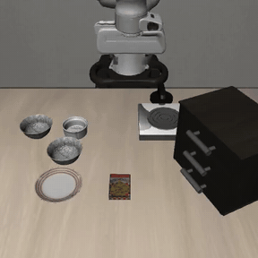 | 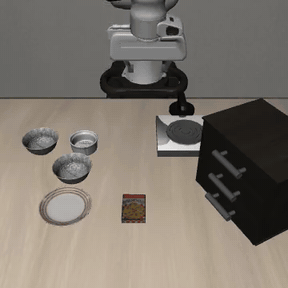 |
| MP4: [`xvla/libero-spatial-5ep.mp4`](showcase/xvla/libero-spatial-5ep.mp4) | MP4: [`smolvla/libero-spatial-5ep.mp4`](showcase/smolvla/libero-spatial-5ep.mp4) |

| `lingbot-va` — LingBot-VA (world action model) · libero_10 (2 tasks × 3 ep) **1.00** · `g6e.2xlarge` | `vla-adapter` — VLA-Adapter-Pro · libero_spatial (10 tasks × 1 trial) **1.00** · `g6.xlarge` |
|---|---|
| 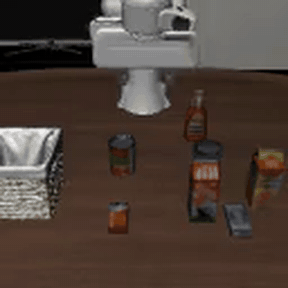 | 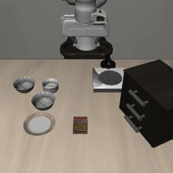 |
| MP4: [`lingbot-va/libero-long-3ep.mp4`](showcase/lingbot-va/libero-long-3ep.mp4) | MP4: [`vla-adapter/libero-spatial-10ep.mp4`](showcase/vla-adapter/libero-spatial-10ep.mp4) |

| `fastwam` — FastWAM (world action model, bf16) · libero_spatial (2 tasks × 5 ep) **0.90** · `g6e.2xlarge` |
|---|
| 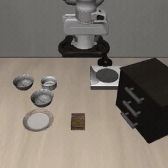 |
| MP4: [`fastwam/libero-spatial-5ep.mp4`](showcase/fastwam/libero-spatial-5ep.mp4) |

| `cosmos-policy` — Cosmos Policy (world action model) · libero_spatial (10 tasks × 1 trial) **1.00** · `g6e.xlarge` | `cosmos-policy` — what the world model predicts: real vs predicted wrist / third-person frames 16 steps ahead |
|---|---|
| 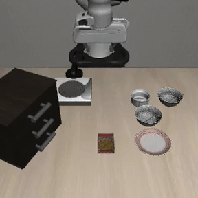 | 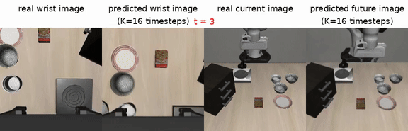 |
| MP4: [`cosmos-policy/libero-spatial-10ep.mp4`](showcase/cosmos-policy/libero-spatial-10ep.mp4) | MP4: [`cosmos-policy/libero-spatial-future-frames-5ep.mp4`](showcase/cosmos-policy/libero-spatial-future-frames-5ep.mp4) |

| `aspire` — ASPIRE (Claude on Bedrock writes the program) · libero_spatial (2 tasks × 5 ep) **1.00** · `g6e.2xlarge` |
|---|
| 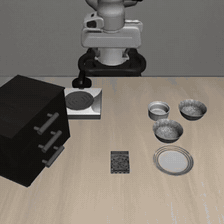 |
| MP4: [`aspire/libero-spatial-10ep.mp4`](showcase/aspire/libero-spatial-10ep.mp4) |

**ASPIRE vs the trained models, same 10 episodes** (LIBERO-Spatial tasks 0-1, saved init states 0-4, ap-northeast-2, 2026-10):

| Target | What runs at test time | Task-specific training | Success (10 ep) | Per-task setup cost |
|---|---|---|---|---|
| `xvla` | X-VLA-0.9B policy | LIBERO fine-tune (checkpoint) | 0.90 | none (download) |
| `smolvla` | SmolVLA-450M policy | LIBERO fine-tune (checkpoint) | 0.80 | none (download) |
| `fastwam` | FastWAM world action model | LIBERO fine-tune (checkpoint) | 0.90 | none (download) |
| `aspire` | a Python program written by Claude (SAM3 segmentation + depth → grasp → IK) | **none** — the agent explored dev seeds 51-65 only | **1.00** | agent 8-18 min, 31-69 turns, **US$0.91-2.30 Bedrock** per task (US$3.21 for both) |

_Read with care: n = 10 on two easy tasks, so 0.90 vs 1.00 is one episode. The point is the trade-off, not the ranking — ASPIRE needs no robot data or fine-tune, but pays an agent session per new task and leans on gated / non-commercial perception tools ([targets note 10](targets.md#note-10-aspire)); the trained policies are a fixed download that generalises across the suite. `vla-adapter` and `cosmos-policy` (1.00 each) were scored on 10 tasks × 1 trial, a different episode set, so they are not in this table._

### `gr00t-gr1` — GR00T N1.6 on RoboCasa GR1 humanoid (22-DOF)

The GR1 humanoid is a different embodiment from Franka Panda — two arms, waist, Fourier dexterous hands. `PosttrainPnPNovelFromPlateToBowlSplitA` is in distribution for the post-trained N1.6 (~80% success), while `PnPCanToDrawerClose` is **not supported** by the pre-trained checkpoint and consistently fails — included to make the embodiment-coverage limitation visible. `g6.12xlarge`, validated 2026-04-10.

| Success — `PosttrainPnPNovelFromPlateToBowlSplitA` (in-distribution) |
|---|
|  |
| MP4: [`gr00t-gr1/posttrain-pnp-plate-to-bowl-success.mp4`](showcase/gr00t-gr1/posttrain-pnp-plate-to-bowl-success.mp4) |

### `openarm-lift-act` — OpenArm unimanual Lift-Cube (Isaac Lab)

> **Not a learned-policy rollout.** Unlike the entries above (each a trained VLA evaluated in LIBERO/RoboCasa), this target runs a **scripted state machine** (`REST → APPROACH → GRASP → LIFT`) on the OpenArm arm in Isaac Lab to *collect* successful pick-and-lift demonstrations — the camera + state + action HDF5 that an ACT policy is then trained on. The clip shows the data-collection rollout, not an evaluated policy. Training ACT on this dataset and showing a *learned* rollout is the next step.

Rendered at 768×768, captured during a `--vla openarm-lift-act` collection run (`g6.12xlarge`, 4× L4, eu-central-1, 2026-06-11). The third-person (table) view is the beauty shot; the wrist view is the gripper POV.

| Third-person (table camera) — pick + lift cube | Wrist camera (gripper POV) |
|---|---|
|  |  |
| MP4: [`openarm-lift-act/lift-cube-table-success.mp4`](showcase/openarm-lift-act/lift-cube-table-success.mp4) | MP4: [`openarm-lift-act/lift-cube-wrist-success.mp4`](showcase/openarm-lift-act/lift-cube-wrist-success.mp4) |

### `spatialvla` · `magma` — zero-shot VLAs on SimplerEnv WidowX (Bridge, authors' eval)

The authors' own SimplerEnv evaluation for both checkpoints ([targets note 19](targets.md#note-19-simplerenv-with-the-authors-own-eval-spatialvla-magma)), ap-northeast-2, 2026-11-02: `spatialvla` run `2026-11-02-1355` on `g6.xlarge`, `magma` run `2026-11-02-1425` on `g6.2xlarge`, 24 episodes per WidowX task. SimplerEnv records the full episode (60 steps carrot, 120 eggplant, 5 fps) whatever the outcome, so the GIFs are sped up. Per-task numbers and the published ones: [results](results.md#simplerenv-with-the-authors-own-eval-spatialvla-magma).

| `magma` — Success, `widowx_put_eggplant_in_basket` (SR 0.79, 19/24) | `magma` — Failure, `widowx_carrot_on_plate` (SR 0.33, 8/24) |
|---|---|
| 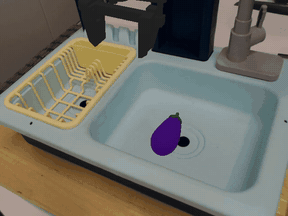 | 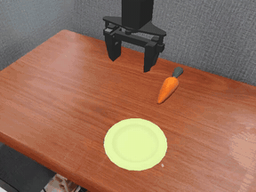 |
| MP4: [`magma/simpler-widowx-eggplant-in-basket-success.mp4`](showcase/magma/simpler-widowx-eggplant-in-basket-success.mp4) (GIF is 4× speed) | MP4: [`magma/simpler-widowx-carrot-on-plate-failure.mp4`](showcase/magma/simpler-widowx-carrot-on-plate-failure.mp4) (GIF is 2× speed) |
| | _The gripper picks the carrot and carries it toward the plate but does not release it there._ |

| `spatialvla` — Failure, `widowx_carrot_on_plate` (SR 0.29, 7/24; published 20.8%) |
|---|
| 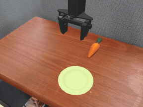 |
| MP4: [`spatialvla/simpler-widowx-carrot-on-plate-failure.mp4`](showcase/spatialvla/simpler-widowx-carrot-on-plate-failure.mp4) (GIF is 2× speed) |
| _The gripper hovers over the carrot and does not close on it. Carrot on plate is SpatialVLA's lowest WidowX task upstream as well (20.8% success, 41.7% grasp)._ |

### `ge-act` — GE-Act on LIBERO-Goal: the default pick-and-place tasks

GE-Act (AgiBot Genie Envisioner) through the authors' LIBERO loop ([targets note 20](targets.md#note-20-libero-with-the-authors-own-loop-univla-ge-act)), ap-northeast-2, `g6.2xlarge`, run `2026-11-02-1355`: bowl on stove 10/10, cream cheese in bowl 8/10, bowl on plate 10/10. The two misses of the run are both on cream cheese; one is below. `univla` scored 30/30 on the same three tasks (run `2026-11-02-1426`). Labels come from the video names (`<task>--episode_<k>-<success|failure>.mp4`).

| Failure — `put the cream cheese in the bowl` (SR 0.8, 8/10; episode 4) |
|---|
| 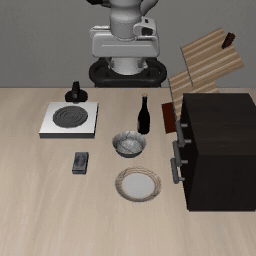 |
| MP4: [`ge-act/libero-goal-cream-cheese-in-bowl-failure.mp4`](showcase/ge-act/libero-goal-cream-cheese-in-bowl-failure.mp4) (GIF is 7× speed) |
| _The arm picks up the bowl instead of the cream cheese and carries it around until the step cap (1,000 frames)._ |

### `vla-jepa` — VLA-JEPA on LIBERO-Goal: the default pick-and-place tasks

VLA-JEPA (Qwen3-VL-2B + flow-matching action head, LeRobot port, [targets note 22](targets.md#note-22-vla-jepa-lerobot-port-on-libero)) through `lerobot-eval`, ap-northeast-2, `g6.xlarge` (one L4), run `2026-11-03-0339`, seed 7: bowl on stove **1.0 (10/10)**, cream cheese in bowl **1.0 (10/10)**, bowl on plate **1.0 (10/10)**. No failure clip: the run has no miss. Labels come from `eval_info.json` (`successes`, one per episode): `lerobot-eval` names the videos `libero_goal_<id>--eval_episode_<k>.mp4` without the outcome. The MP4s are written at 80 fps, one frame per 20 Hz control step (4× real time); the GIFs play at real time unless noted.

| Success — `put the bowl on the stove` (SR 1.0, 10/10; episode 0) | Success — `put the cream cheese in the bowl` (SR 1.0, 10/10; episode 0) | Success — `put the bowl on the plate` (SR 1.0, 10/10; episode 0) |
|---|---|---|
|  |  | 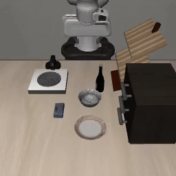 |
| MP4: [`vla-jepa/libero-goal-bowl-on-stove-success.mp4`](showcase/vla-jepa/libero-goal-bowl-on-stove-success.mp4) | MP4: [`vla-jepa/libero-goal-cream-cheese-in-bowl-success.mp4`](showcase/vla-jepa/libero-goal-cream-cheese-in-bowl-success.mp4) | MP4: [`vla-jepa/libero-goal-bowl-on-plate-success.mp4`](showcase/vla-jepa/libero-goal-bowl-on-plate-success.mp4) |
| _86 control steps (4.3 s)._ | _87 steps._ | _72 steps._ |

## Articulated: doors, drawers, knobs

Open, close or turn a jointed fixture: cabinet doors, drawers, a microwave door, a stove knob.

### `openvla-oft` — `turn on the stove and put the moka pot on it` (LIBERO-10)

Same OpenVLA-OFT LIBERO-10 run as in [pick and place](#openvla-oft--openvla-oft-on-libero-10-long-horizon): the stove knob comes first, then the moka pot.

| `turn on the stove and put the moka pot on it` |
|---|
|  |
| MP4: [`openvla-oft/libero-10-stove-moka-pot-success.mp4`](showcase/openvla-oft/libero-10-stove-moka-pot-success.mp4) |

### `rldx` — `KITCHEN_SCENE6`: mug into the microwave, then close it (LIBERO-10)

Same RLDX-1 LIBERO-10 run as in [pick and place](#rldx--rldx-1-rlwrld-on-libero-10-long-horizon-franka-panda-7-dof); `success_rate = 0.8` (4/5), two-stage with an articulated close.

| Success — `KITCHEN_SCENE6: put the yellow and white mug in the microwave and close it` (SR 0.8, 4/5) |
|---|
|  |
| MP4: [`rldx/libero10-kitchen-mug-microwave-success.mp4`](showcase/rldx/libero10-kitchen-mug-microwave-success.mp4) |
| Failure (1/5) — same task, hits the 90-step cap without closing: |
|  |
| MP4: [`rldx/libero10-kitchen-mug-microwave-failure.mp4`](showcase/rldx/libero10-kitchen-mug-microwave-failure.mp4) (clip is 2× speed) |

> **Reading the success rate — "success" is a binary goal flag, not a quality score.** LIBERO marks an episode `success` the moment its BDDL goal predicate is satisfied; it says nothing about how cleanly or how close to the failure boundary the policy got there. That distinction matters on long-horizon tasks:
> - `STUDY_SCENE1` (SR 1.0) is genuinely robust — every episode finishes in 20–23 env-steps with margin to spare.
> - `KITCHEN_SCENE6` (SR 0.8) is **marginal even when it succeeds**: successful episodes range from a clean 32 steps to a labored 47 steps, while the failure runs the full 90-step cap (a *timeout*, not a hard error). The scene also contains a second (grey) mug as a distractor next to the yellow/white target. A near-cap success is one perturbation away from a timeout — so treat 0.8 here as "works, but not yet deployment-margin," not as a 4-in-5 guarantee of reliable execution.
>
> Takeaway for demos: pair the SR number with the **step-count spread** (in `simulation_results.csv`) and watch the failure clip — a high SR with episodes clustered near the step cap is a weaker result than the same SR with short, consistent runs.

### `rldx-gr1` — RLDX-1 (RLWRLD) on RoboCasa GR-1 Tabletop (bimanual humanoid + waist)

Same RLDX-1 family as `rldx`/`rldx-simpler`, but on **RoboCasa GR-1 Tabletop** with RLWRLD's own `RLDX-1-FT-GR1` checkpoint — the only target here on a **bimanual humanoid with a waist DOF** (`GR1ArmsAndWaistFourierHands`: two 7-DOF arms + Fourier dexterous hands + waist), distinct from every single-arm LIBERO/SimplerEnv clip. Each clip is dual-view (left ego / right third-person); the policy controls both hands and the waist to manipulate **articulated** scene objects (a drawer, a microwave door). Served eager via the same ZeroMQ policy server + sim client (two venvs, MuJoCo/robosuite headless EGL — no Vulkan), `g5.2xlarge` A10G 24 GB, validated 2026-06-25 via a full `deploy.py` 1-shot smoke. Two articulated tasks at n=5: `PnPCupToDrawerClose` `success_rate = 0.80` (4/5) and `PnPMilkToMicrowaveClose` `success_rate = 0.20` (1/5) — the combined 5/10 is consistent with the paper's 58.7% 24-task average. Weights are **non-commercial** (RLWRLD Model License v1.0) — sim benchmarking only.

| Success — `PnPCupToDrawerClose` (SR 0.80, 4/5) | Success — `PnPMilkToMicrowaveClose` (SR 0.20, 1/5) |
|---|---|
|  |  |
| MP4: [`rldx-gr1/gr1-cup-drawer-success.mp4`](showcase/rldx-gr1/gr1-cup-drawer-success.mp4) | MP4: [`rldx-gr1/gr1-milk-microwave-success.mp4`](showcase/rldx-gr1/gr1-milk-microwave-success.mp4) |
| _Clean bimanual pick-place-close in 19 env-steps; the harder of the two tasks the policy reliably solves._ | _The rare success on the hard task (24 steps) — most runs time out (see failure clip)._ |

| Failure — `PnPMilkToMicrowaveClose` (4/5 of this task, step-cap timeout) |
|---|
|  |
| MP4: [`rldx-gr1/gr1-milk-microwave-failure.mp4`](showcase/rldx-gr1/gr1-milk-microwave-failure.mp4) (clip is 2× speed) |
| _The dominant outcome on the microwave task: the run hits the 45-step cap (a *timeout*, not a hard error) without satisfying the goal predicate. SR 0.20 here means "rarely solved," not "1-in-5 reliable" — pair the number with the per-episode step counts in `simulation_results.csv`._ |

### `rldx-kitchen` — RLDX-1 (RLWRLD) on RoboCasa Kitchen (PandaOmron mobile manipulator)

Same RLDX-1 family again, but on the **RoboCasa Kitchen** 24-task benchmark with RLWRLD's own `RLDX-1-FT-ROBOCASA` checkpoint — a **single-arm mobile manipulator** (`PandaOmron`: a Franka Panda arm on an Omron LD mobile base) operating **articulated kitchen fixtures** (cabinet doors, drawers) inside full procedurally-generated kitchen scenes, distinct from the GR-1 humanoid and every LIBERO/SimplerEnv clip. Each clip is a three-camera strip — the two external views (left / right) plus the wrist camera, exactly the views the policy consumes. Served eager via the same ZeroMQ policy server + sim client (two venvs, MuJoCo/robosuite headless EGL — no Vulkan), `g6.2xlarge` L4 24 GB, validated 2026-06-26 via a full `deploy.py` 1-shot smoke. Two articulated tasks at n=5: `OpenSingleDoor` `success_rate = 0.80` (4/5) and `OpenDrawer` `success_rate = 0.80` (4/5) — consistent with the paper's 70.6% 24-task average. Weights are **non-commercial** (RLWRLD Model License v1.0) — sim benchmarking only.

> RoboCasa Kitchen's env emits each of the three cameras at two resolutions (a 256-px policy input + a raw 512-px copy), and the stock video recorder stacks **all** of them — so the unfiltered MP4 is a six-panel strip showing every camera twice. A target-gated runtime fix (FIX 10) narrows the recorder to the 256-px views, giving the clean three-panel video below. The clips here are post-processed to that same three-panel form; FIX 10 makes it the default on the next deploy.

| Success — `OpenSingleDoor` (SR 0.80, 4/5) | Success — `OpenDrawer` (SR 0.80, 4/5) |
|---|---|
|  |  |
| MP4: [`rldx-kitchen/kitchen-open-single-door-success.mp4`](showcase/rldx-kitchen/kitchen-open-single-door-success.mp4) | MP4: [`rldx-kitchen/kitchen-open-drawer-success.mp4`](showcase/rldx-kitchen/kitchen-open-drawer-success.mp4) |
| _Three-camera strip (left / right / wrist); the arm reaches the cabinet handle and swings the door open in 18 env-steps._ | _Distinct mobile-manipulator embodiment — the PandaOmron base + arm pulls the drawer open in 16 env-steps._ |

| Failure — `OpenSingleDoor` (1/5 of this task, step-cap timeout) |
|---|
|  |
| MP4: [`rldx-kitchen/kitchen-open-single-door-failure.mp4`](showcase/rldx-kitchen/kitchen-open-single-door-failure.mp4) (clip is 2× speed) |
| _The one miss on the door task: the run hits the 45-step cap (a *timeout*, not a hard error) without latching the handle. SR 0.80 here means "usually solved" — pair the number with the per-episode step counts in `simulation_results.csv`._ |

**`--task-set actions` run** (ap-northeast-2, `g6.2xlarge`, 2026-11-02, run `2026-11-02-0850`, 6 tasks × 5 episodes): `OpenSingleDoor` 1.0 (5/5), `OpenDrawer` 0.6 (3/5), `CloseDrawer` 1.0 (5/5), `TurnOnStove` 0.4 (2/5), `TurnOnSinkFaucet` 1.0 (5/5) and `CoffeePressButton` 1.0 (5/5, under [press](#press-buttons-and-bells)). Success labels come from the per-episode file names (`…-episode_N-success.mp4`).

| Success — `CloseDrawer` (SR 1.0, 5/5) | Success — `TurnOnSinkFaucet` (SR 1.0, 5/5) |
|---|---|
| 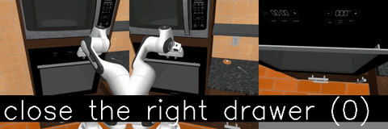 | 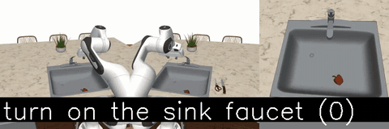 |
| MP4: [`rldx-kitchen/kitchen-close-drawer-success.mp4`](showcase/rldx-kitchen/kitchen-close-drawer-success.mp4) | MP4: [`rldx-kitchen/kitchen-turn-on-sink-faucet-success.mp4`](showcase/rldx-kitchen/kitchen-turn-on-sink-faucet-success.mp4) |
| _Pushes the open drawer shut in 12 env-steps (episodes 12–30 steps)._ | _Lifts the faucet lever in 10 env-steps (episodes 10–21 steps)._ |

| Success — `TurnOnStove` (SR 0.4, 2/5) | Failure — `TurnOnStove` (3/5 of this task, step-cap timeout) |
|---|---|
| 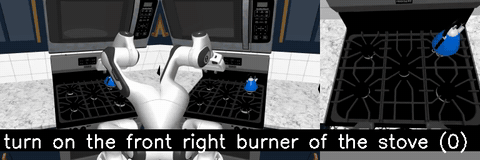 | 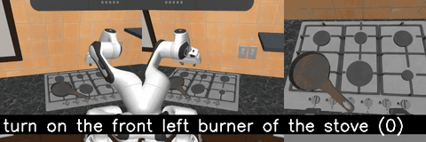 |
| MP4: [`rldx-kitchen/kitchen-turn-on-stove-success.mp4`](showcase/rldx-kitchen/kitchen-turn-on-stove-success.mp4) | MP4: [`rldx-kitchen/kitchen-turn-on-stove-failure.mp4`](showcase/rldx-kitchen/kitchen-turn-on-stove-failure.mp4) (GIF is 3× speed) |
| _The two successes take 7 and 14 env-steps._ | _The three misses all run the full 45-step cap without turning the knob far enough. The rotary knob is the hardest of the five articulated fixtures here._ |

### `rldx-simpler` — Google Robot open / close drawer (SimplerEnv Fractal)

Same RLDX-1 SimplerEnv target as in [pick and place](#rldx-simpler--rldx-1-rlwrld-on-simplerenv-google-fractal-real-robot-embodiment), `--task-set actions` run (ap-northeast-2, `g6.2xlarge`, 2026-11-02, run `2026-11-02-0850`, 2 tasks × 5 episodes): `google_robot_open_drawer` 0.4 (2/5) and `google_robot_close_drawer` 0.8 (4/5). Every miss runs the 150-step cap. Clips are slowed (rate overlaid top-left) because the episodes are short.

| Success — `google_robot_open_drawer` (SR 0.4, 2/5), shown at 0.5× | Success — `google_robot_close_drawer` (SR 0.8, 4/5), shown at 0.25× |
|---|---|
| 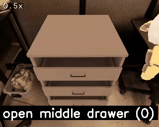 | 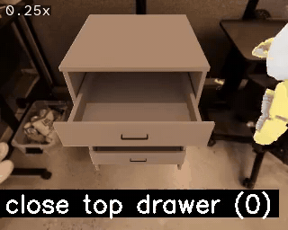 |
| MP4: [`rldx-simpler/simpler-google-open-drawer-success.mp4`](showcase/rldx-simpler/simpler-google-open-drawer-success.mp4) | MP4: [`rldx-simpler/simpler-google-close-drawer-success.mp4`](showcase/rldx-simpler/simpler-google-close-drawer-success.mp4) |
| _54 env-steps; the other success took 100. Opening is the harder direction here._ | _12 env-steps; successes take 12–38 steps._ |

### `spatialvla` — SpatialVLA on Google Robot open / close top drawer (SimplerEnv, authors' eval)

`--task-set actions` run, ap-northeast-2, `g6.xlarge`, 2026-11-02, run `2026-11-02-1556`: the authors' `drawer_visual_matching.sh` with the first URDF variant, 9 robot positions per task. `google_robot_open_top_drawer` **0.56 (5/9)**, `google_robot_close_top_drawer` **0.44 (4/9)**; the SpatialVLA README reports 59.3% for open / close drawer (visual matching, all drawers). Every episode runs the 113-step cap (about 23 s at 5 fps), so the GIFs are 3× speed.

| Success — `open top drawer` (SR 0.56, 5/9) | Failure — `open top drawer` (4/9 of this task) |
|---|---|
| 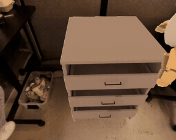 | 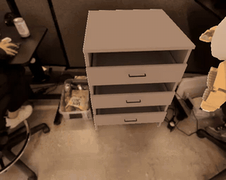 |
| MP4: [`spatialvla/simpler-google-open-top-drawer-success.mp4`](showcase/spatialvla/simpler-google-open-top-drawer-success.mp4) | MP4: [`spatialvla/simpler-google-open-top-drawer-failure.mp4`](showcase/spatialvla/simpler-google-open-top-drawer-failure.mp4) |
| | _The arm reaches the cabinet but the top drawer stays shut for the whole episode._ |

| Success — `close top drawer` (SR 0.44, 4/9) | Failure — `close top drawer` (5/9 of this task) |
|---|---|
| 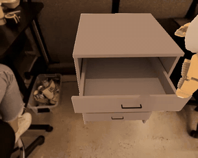 | 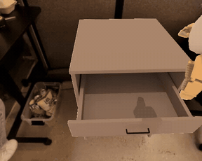 |
| MP4: [`spatialvla/simpler-google-close-top-drawer-success.mp4`](showcase/spatialvla/simpler-google-close-top-drawer-success.mp4) | MP4: [`spatialvla/simpler-google-close-top-drawer-failure.mp4`](showcase/spatialvla/simpler-google-close-top-drawer-failure.mp4) |
| | _The arm drops below the open drawer and never pushes it shut._ |

### `magma` — Magma-8B open the top drawer and put the apple in (SimplerEnv)

`--task-set actions` run, ap-northeast-2, `g6.2xlarge`, 2026-11-02, run `2026-11-02-1622`: Magma's `put_drawer_visual_matching.sh` (`PlaceIntoClosedTopDrawerCustomInScene-v0`) with the first URDF variant, 3 robot positions × 9 apple spots. `google_robot_put_apple_in_top_drawer` **0.11 (3/27)**; Magma publishes no per-task number for it, only the 52.3% Google Robot average ([results](results.md#simplerenv-with-the-authors-own-eval-spatialvla-magma)). Every episode runs the 200-step cap (40 s at 5 fps), so the GIFs are 5× speed.

| Success — `put apple in top drawer` (SR 0.11, 3/27; episode 17) | Failure — `put apple in top drawer` (24/27 of this task; episode 16) |
|---|---|
| 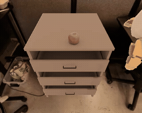 | 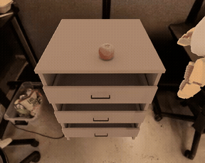 |
| MP4: [`magma/simpler-google-apple-in-top-drawer-success.mp4`](showcase/magma/simpler-google-apple-in-top-drawer-success.mp4) | MP4: [`magma/simpler-google-apple-in-top-drawer-failure.mp4`](showcase/magma/simpler-google-apple-in-top-drawer-failure.mp4) |
| _The arm pulls the top drawer open, picks the apple from the cabinet top and drops it into the drawer._ | _Same robot position: the drawer is pulled open, but the arm then hovers around the apple on the cabinet top and never grasps it._ |

### `gr00t-gr1` — `PnPCanToDrawerClose` (not supported by N1.6)

Same GR00T-GR1 run as in [pick and place](#gr00t-gr1--gr00t-n16-on-robocasa-gr1-humanoid-22-dof): the drawer-close task is outside what the pre-trained N1.6 checkpoint supports and consistently fails.

| Failure — `PnPCanToDrawerClose` (not supported by N1.6) |
|---|
|  |
| MP4: [`gr00t-gr1/pnp-can-to-drawer-failure.mp4`](showcase/gr00t-gr1/pnp-can-to-drawer-failure.mp4) |

### `gr00t` — GR00T N1.7 on LIBERO-10 (Franka Panda)

Default LIBERO-10 tasks, both two-stage with a fixture motion (us-west-2, `g6.4xlarge`, run `2026-09-08-1949`): `KITCHEN_SCENE3` stove + moka pot 1.0 (5/5) and `KITCHEN_SCENE4` bowl into drawer + close 1.0 (3/3).

| Success — `KITCHEN_SCENE3: turn on the stove and put the moka pot on it` (SR 1.0, 5/5) | Success — `KITCHEN_SCENE4: put the black bowl in the bottom drawer of the cabinet and close it` (SR 1.0, 3/3) |
|---|---|
| 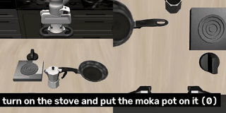 | 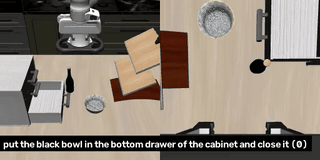 |
| MP4: [`gr00t/libero10-scene3-stove-moka-success.mp4`](showcase/gr00t/libero10-scene3-stove-moka-success.mp4) | MP4: [`gr00t/libero10-scene4-bowl-drawer-close-success.mp4`](showcase/gr00t/libero10-scene4-bowl-drawer-close-success.mp4) |

**`--task-set actions` run** — single-motion LIBERO-Goal tasks on the `libero_goal` checkpoint of the same repo (ap-northeast-2, `g6.12xlarge`, 2026-11-02, run `2026-11-02-0851`, 3 tasks × 5 episodes): `open_the_middle_drawer_of_the_cabinet` 0.8 (4/5), `turn_on_the_stove` 1.0 (5/5) and `push_the_plate_to_the_front_of_the_stove` 1.0 (5/5, under [push](#push)). Video names end in `_s1` (success) or `_s0` (failure).

| Success — `open the middle drawer of the cabinet` (SR 0.8, 4/5) | Success — `turn on the stove` (SR 1.0, 5/5) |
|---|---|
| 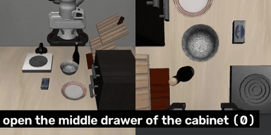 | 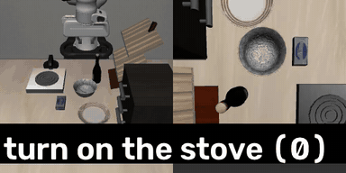 |
| MP4: [`gr00t/libero-goal-open-middle-drawer-success.mp4`](showcase/gr00t/libero-goal-open-middle-drawer-success.mp4) | MP4: [`gr00t/libero-goal-turn-on-stove-success.mp4`](showcase/gr00t/libero-goal-turn-on-stove-success.mp4) |
| _The one miss on this task runs the full 720-step cap._ | |

Carries a `mujoco==3.3.1` pin (FIX 14, `sim_protect_pins`): mujoco 3.10.0 shipped 2026-06-22 — after this target validated 2026-04-27 — and its `mj_fullM` signature change breaks robosuite's call site, so `setup_libero.sh`'s own closing env check fails on a clean deploy without the pin (see [#4](https://github.com/aws-samples/sample-rfm-simulation-on-aws/issues/4)).

### `multitask-dit` — Multi-task DiT (LBM-style LeRobot port) on the same LIBERO-10 stove task

Contrast with the `gr00t` SCENE3 clip above: the same `turn on the stove and put the moka pot on it` task, run by LeRobot's `multi_task_dit` policy (an implementation based on TRI's LBM paper; **not TRI's weights**, which are not public) from the only public simulator checkpoint, a community upload trained for 15,000 steps at batch size 2 (`LuigiDu/multitask-dit-libero10-all-seed1000`). LeRobot's documented recipe is 100k steps at batch size 320, so this is a pipeline check of the policy class, not a measure of what LBM-style models can do. ap-northeast-2, `g6.xlarge`, 2026-11-02, run `2026-11-02-0931`: LIBERO-10 tasks 2 and 3 × 5 episodes = **0/10** (max reward 0 in every episode, `eval_info.json`).

| Failure — `KITCHEN_SCENE3: turn on the stove and put the moka pot on it` (0/5 on this task, 0/10 overall) |
|---|
| 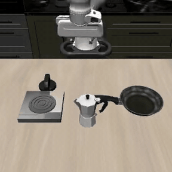 |
| MP4: [`multitask-dit/libero10-scene3-stove-moka-failure.mp4`](showcase/multitask-dit/libero10-scene3-stove-moka-failure.mp4) |
| _Episode 0: the arm moves toward the scene objects but never satisfies the goal before the episode ends._ |

### `univla` · `ge-act` — LIBERO-Goal open the middle drawer, turn on the stove (authors' loops)

`--task-set actions` runs, ap-northeast-2, 2026-11-02, 10 episodes per task from LIBERO's fixed init states 0-9: `univla` run `2026-11-02-1519` (`g6e.xlarge`, L40S) and `ge-act` run `2026-11-02-1430` (`g6.2xlarge`, L4). Open the middle drawer: `univla` **0.8 (8/10)**, `ge-act` **1.0 (10/10)**. Turn on the stove: both **1.0 (10/10)**. The same tasks run by GR00T N1.7 are [above](#gr00t--gr00t-n17-on-libero-10-franka-panda) (4/5 and 5/5). Labels come from the video names (`<task>--episode_<k>-<success|failure>.mp4`).

| `univla` — Success, `open the middle drawer of the cabinet` (episode 0) | `univla` — Failure, `open the middle drawer of the cabinet` (2/10; episode 1) |
|---|---|
|  |  |
| MP4: [`univla/libero-goal-open-middle-drawer-success.mp4`](showcase/univla/libero-goal-open-middle-drawer-success.mp4) | MP4: [`univla/libero-goal-open-middle-drawer-failure.mp4`](showcase/univla/libero-goal-open-middle-drawer-failure.mp4) (GIF is 2× speed) |
| | _The arm goes to the bowl and plate first and is still at the cabinet when the 300-step cap ends the episode._ |

| `ge-act` — Success, `open the middle drawer of the cabinet` (SR 1.0, 10/10) | `univla` — Success, `turn on the stove` (SR 1.0, 10/10) | `ge-act` — Success, `turn on the stove` (SR 1.0, 10/10) |
|---|---|---|
|  | 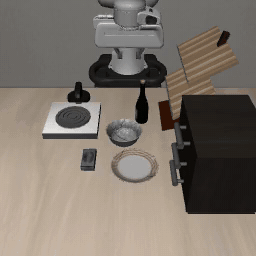 | 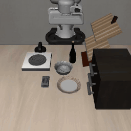 |
| MP4: [`ge-act/libero-goal-open-middle-drawer-success.mp4`](showcase/ge-act/libero-goal-open-middle-drawer-success.mp4) | MP4: [`univla/libero-goal-turn-on-stove-success.mp4`](showcase/univla/libero-goal-turn-on-stove-success.mp4) | MP4: [`ge-act/libero-goal-turn-on-stove-success.mp4`](showcase/ge-act/libero-goal-turn-on-stove-success.mp4) |
| | _Both models turn the knob in about 4 s (80-90 env-steps)._ | |

### `vla-jepa` — LIBERO-Goal open the middle drawer, turn on the stove

`--task-set actions` run `2026-11-03-0455` (ap-northeast-2, `g6.xlarge`, seed 7, init states 0-9): open the middle drawer **0.9 (9/10)**, turn on the stove **1.0 (10/10)**. The drawer miss is episode 6, below. Same tasks for `univla` / `ge-act` [above](#univla--ge-act--libero-goal-open-the-middle-drawer-turn-on-the-stove-authors-loops). Labels and frame rate as in [pick and place](#vla-jepa--vla-jepa-on-libero-goal-the-default-pick-and-place-tasks).

| Success — `open the middle drawer of the cabinet` (episode 0) | Failure — `open the middle drawer of the cabinet` (1/10; episode 6) | Success — `turn on the stove` (SR 1.0, 10/10; episode 0) |
|---|---|---|
|  | 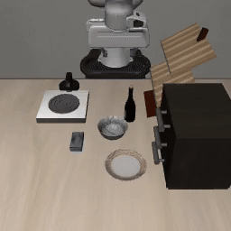 | 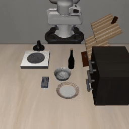 |
| MP4: [`vla-jepa/libero-goal-open-middle-drawer-success.mp4`](showcase/vla-jepa/libero-goal-open-middle-drawer-success.mp4) | MP4: [`vla-jepa/libero-goal-open-middle-drawer-failure.mp4`](showcase/vla-jepa/libero-goal-open-middle-drawer-failure.mp4) (GIF is 2× real time) | MP4: [`vla-jepa/libero-goal-turn-on-stove-success.mp4`](showcase/vla-jepa/libero-goal-turn-on-stove-success.mp4) |
| _119 steps._ | _The arm reaches the cabinet but the drawer is not open when the 300-step cap ends the episode._ | _73 steps._ |

## Press: buttons and bells

Press a button or bell: a short, precise contact motion with no grasp.

| `rldx-kitchen` — `CoffeePressButton` (SR 1.0, 5/5) · RoboCasa Kitchen, `g6.2xlarge`, run `2026-11-02-0850` | `lingbot-vla2` — RoboTwin `click_bell` (SR 1.0, 5/5) · `g6e.2xlarge`, run `2026-10-30-1728` |
|---|---|
| 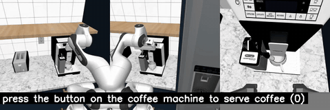 | 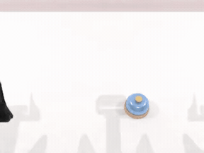 |
| MP4: [`rldx-kitchen/kitchen-coffee-press-button-success.mp4`](showcase/rldx-kitchen/kitchen-coffee-press-button-success.mp4) | MP4: [`lingbot-vla2/robotwin-click-bell-success.mp4`](showcase/lingbot-vla2/robotwin-click-bell-success.mp4) |
| _Every episode presses the start button in 8–9 env-steps._ | _`smolvla-robotwin` also scores 5/5 on this task in the same run._ |

## Push

Move an object by pushing it, without grasping it.

### `gr00t` — `push the plate to the front of the stove` (LIBERO-Goal)

Same `--task-set actions` run as in [articulated](#gr00t--gr00t-n17-on-libero-10-franka-panda) (ap-northeast-2, `g6.12xlarge`, run `2026-11-02-0851`): 1.0 (5/5).

| Success — `push the plate to the front of the stove` (SR 1.0, 5/5) |
|---|
| 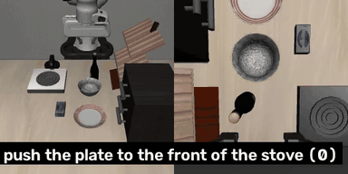 |
| MP4: [`gr00t/libero-goal-push-plate-success.mp4`](showcase/gr00t/libero-goal-push-plate-success.mp4) |

### `univla` · `ge-act` — `push the plate to the front of the stove` (LIBERO-Goal)

Same `--task-set actions` runs as in [articulated](#univla--ge-act--libero-goal-open-the-middle-drawer-turn-on-the-stove-authors-loops): `univla` **0.9 (9/10)**, `ge-act` **1.0 (10/10)**.

| `univla` — Success (episode 0) | `univla` — Failure (1/10; episode 1) | `ge-act` — Success (SR 1.0, 10/10) |
|---|---|---|
| 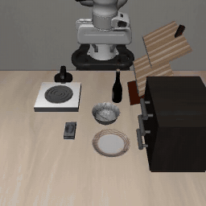 |  |  |
| MP4: [`univla/libero-goal-push-plate-success.mp4`](showcase/univla/libero-goal-push-plate-success.mp4) (GIF is 2× speed) | MP4: [`univla/libero-goal-push-plate-failure.mp4`](showcase/univla/libero-goal-push-plate-failure.mp4) (GIF is 2× speed) | MP4: [`ge-act/libero-goal-push-plate-success.mp4`](showcase/ge-act/libero-goal-push-plate-success.mp4) |
| | _The plate moves, but not to the front of the stove before the 300-step cap._ | |

### `vla-jepa` — `push the plate to the front of the stove` (LIBERO-Goal)

Same `actions` run as in [articulated](#vla-jepa--libero-goal-open-the-middle-drawer-turn-on-the-stove): **0.9 (9/10)**; the miss is episode 9.

| Success (episode 0) | Failure (1/10; episode 9) |
|---|---|
|  | 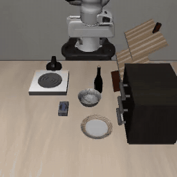 |
| MP4: [`vla-jepa/libero-goal-push-plate-success.mp4`](showcase/vla-jepa/libero-goal-push-plate-success.mp4) | MP4: [`vla-jepa/libero-goal-push-plate-failure.mp4`](showcase/vla-jepa/libero-goal-push-plate-failure.mp4) (GIF is 2× real time) |
| _137 steps._ | _The plate is not at the front of the stove when the 300-step cap ends the episode._ |

### `lerobot-gym` — Diffusion Policy on Push-T

LeRobot's reference Diffusion Policy checkpoint (`lerobot/diffusion_pusht`) on gym-pusht `PushT-v0`: push the T-shaped block onto the target pose; an episode succeeds when the overlap reaches 95%. ap-northeast-2, `g6.xlarge`, 2026-11-02, run `2026-11-02-1056`: **0.8 (8/10)**, average max overlap 0.99. The model card reports 65.4% over 500 episodes; 10 episodes is a small sample (95% interval 49-94%).

| Success — `PushT-v0` (SR 0.8, 8/10) |
|---|
| 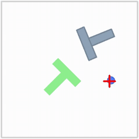 |
| MP4: [`lerobot-gym/pusht-success.mp4`](showcase/lerobot-gym/pusht-success.mp4) (GIF is 4× speed) |

### `dino-wm` · `jepa-wms` — latent world-model planners on Push-T

Goal-image planners, not language policies ([targets note 21](targets.md#note-21-latent-world-model-planners-dino-wm-jepa-wms)): the world model plans actions toward a goal image from the authors' validation set, and the authors' own success test decides the episode. Labels come from the video names (`<task>--ep<k>-<success|failure>.mp4`, jepa-wms `<task>--<model>--ep<k>-...`).

- `dino-wm`: the original DINO-WM `pusht` checkpoint with its MPC + CEM planner, ap-northeast-2, `g6e.xlarge` (one L40S), run `2026-11-02-2225`: **1.0 (20/20)** (paper 0.90). No failure clip: the run has no miss. The video is the authors' side-by-side: simulator frames on top, the world model's decoded prediction below, the goal image on the right.
- `jepa-wms --task-set compare`: JEPA-WM `jepa_wm_pusht` **0.6 (6/10)** and the jepa-wms authors' retrained DINO-WM baseline `dino_wm_pusht` **0.4 (4/10)**, one CEM plan per episode, ap-northeast-2, `g6.xlarge` (one L4), run `2026-11-02-2103`. Episode *k* starts from the same state for both models (seed 1; the first frames are identical). These videos are the simulator frames of the executed plan (31 frames; the target T is the green shape). The GIFs play the frames at 10 fps (MP4: 30 fps).

| `dino-wm` — Success, `pusht` (SR 1.0, 20/20; episode 0) |
|---|
| 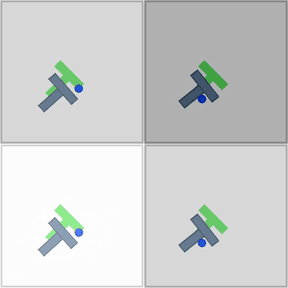 |
| MP4: [`dino-wm/pusht-success.mp4`](showcase/dino-wm/pusht-success.mp4) |

| `jepa-wms` JEPA-WM — Success, episode 1 | DINO-WM baseline — Failure, same episode 1 |
|---|---|
|  | 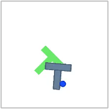 |
| MP4: [`jepa-wms/pusht-jepa-wm-ep01-success.mp4`](showcase/jepa-wms/pusht-jepa-wm-ep01-success.mp4) | MP4: [`jepa-wms/pusht-dino-wm-ep01-failure.mp4`](showcase/jepa-wms/pusht-dino-wm-ep01-failure.mp4) |
| | _The T ends next to the target but not aligned with it._ |

| `jepa-wms` JEPA-WM — Failure, episode 0 (both models miss it) | DINO-WM baseline — Success, episode 3 (JEPA-WM also succeeds) |
|---|---|
| 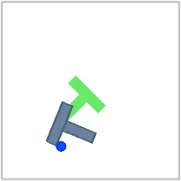 | 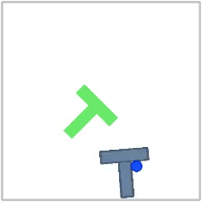 |
| MP4: [`jepa-wms/pusht-jepa-wm-ep00-failure.mp4`](showcase/jepa-wms/pusht-jepa-wm-ep00-failure.mp4) | MP4: [`jepa-wms/pusht-dino-wm-ep03-success.mp4`](showcase/jepa-wms/pusht-dino-wm-ep03-success.mp4) |
| _The T overlaps the target but is offset and rotated._ | |

## Navigation

Move a point agent to a goal position with no object contact (`navigation` in [targets: task sets and action types](targets.md#task-sets-and-action-types)). Same runs and labels as the [Push-T clips](#dino-wm--jepa-wms--latent-world-model-planners-on-push-t).

### `dino-wm` · `jepa-wms` — Wall: through the door to the goal

The agent (red dot) starts on one side of a wall and has to pass through the door to reach the goal on the other side.

- `dino-wm` `wall_single`, run `2026-11-02-2225`: **0.95 (19/20)** (paper 0.96); the miss is episode 15. Side-by-side layout as on Push-T (simulator top, prediction bottom, goal right).
- `jepa-wms --task-set compare`, run `2026-11-02-2103`: JEPA-WM `jepa_wm_wall` **0.8 (8/10)**, DINO-WM baseline `dino_wm_wall` **0.6 (6/10)**. The jepa-wms videos show the simulator only; the goal is not drawn.

| `dino-wm` — Success, `wall` (SR 0.95, 19/20; episode 0) | `dino-wm` — Failure, `wall` (1/20; episode 15) |
|---|---|
| 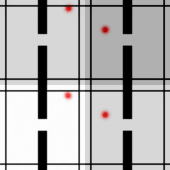 | 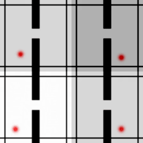 |
| MP4: [`dino-wm/wall-success.mp4`](showcase/dino-wm/wall-success.mp4) (GIF is 2× speed) | MP4: [`dino-wm/wall-failure.mp4`](showcase/dino-wm/wall-failure.mp4) (GIF is 2× speed) |
| | _The agent moves to the wall next to the door but stays on the start side; the goal is on the other side._ |

| `jepa-wms` JEPA-WM — Success, episode 5 | DINO-WM baseline — Failure, same episode 5 |
|---|---|
| 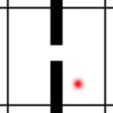 | 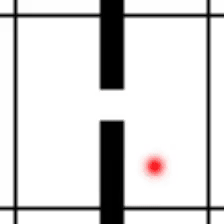 |
| MP4: [`jepa-wms/wall-jepa-wm-ep05-success.mp4`](showcase/jepa-wms/wall-jepa-wm-ep05-success.mp4) | MP4: [`jepa-wms/wall-dino-wm-ep05-failure.mp4`](showcase/jepa-wms/wall-dino-wm-ep05-failure.mp4) |
| | _From the same start JEPA-WM passes through the door; the baseline ends on the start side of the wall._ |

| `jepa-wms` JEPA-WM — Failure, episode 3 (both models miss it) | DINO-WM baseline — Success, episode 0 (JEPA-WM also succeeds) |
|---|---|
| 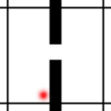 | 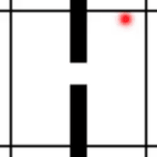 |
| MP4: [`jepa-wms/wall-jepa-wm-ep03-failure.mp4`](showcase/jepa-wms/wall-jepa-wm-ep03-failure.mp4) | MP4: [`jepa-wms/wall-dino-wm-ep00-success.mp4`](showcase/jepa-wms/wall-dino-wm-ep00-success.mp4) |

## Bimanual

Both arms act on the scene: one hands an object to the other, both lift it together, or each holds one part of an assembly. RoboTwin 2.0 (`aloha-agilex` dual arm, clean setting), run `2026-10-30-1728` in ap-northeast-2. RoboTwin video names carry the episode index only; success labels below come from `eval_info.json` (`per_task[].metrics.successes`).

| `lingbot-vla2` — `handover_block` (SR 1.0, 5/5) · `g6e.2xlarge` | `lingbot-vla2` — `lift_pot` (SR 0.6, 3/5) · `g6e.2xlarge` |
|---|---|
|  |  |
| MP4: [`lingbot-vla2/robotwin-handover-block-success.mp4`](showcase/lingbot-vla2/robotwin-handover-block-success.mp4) (GIF is 1.5× speed) | MP4: [`lingbot-vla2/robotwin-lift-pot-success.mp4`](showcase/lingbot-vla2/robotwin-lift-pot-success.mp4) |
| _One arm picks the block and passes it to the other, which places it on the target._ | _Both arms grip the pot handles and lift it together (episode 0, a success)._ |

| Failure — `smolvla-robotwin` — `handover_block` (SR 0.0, 0/5) · `g6.2xlarge` |
|---|
|  |
| MP4: [`smolvla-robotwin/robotwin-handover-block-failure.mp4`](showcase/smolvla-robotwin/robotwin-handover-block-failure.mp4) (GIF is 4× speed) |
| _Same task and seeds, smaller policy: all five episodes miss. The handover is where the two RoboTwin policies differ most (5/5 vs 0/5)._ |

### `lerobot-gym` — ACT on ALOHA sim (insertion, cube transfer)

LeRobot's reference ACT checkpoints, one per task, trained on human demonstrations (`lerobot/act_aloha_sim_insertion_human`, `lerobot/act_aloha_sim_transfer_cube_human`), on gym-aloha (two 6-DOF arms, MuJoCo). ap-northeast-2, `g6.xlarge`, 2026-11-02, run `2026-11-02-1056`, 10 episodes per task from seed 1000: `AlohaInsertion-v0` **0.1 (1/10)**, `AlohaTransferCube-v0` **0.7 (7/10)**. The ACT paper (Table I, human data, 3 seeds × 50 trials) reports 20% insertion and 50% transfer; at 10 episodes both are within sampling noise (95% intervals 2-40% and 40-89%). Labels come from the video names (`<task>--eval_episode_N-<success|failure>.mp4`).

| Success — `AlohaInsertion-v0` (SR 0.1, 1/10; episode 5) | Success — `AlohaTransferCube-v0` (SR 0.7, 7/10; episode 1) |
|---|---|
|  |  |
| MP4: [`lerobot-gym/aloha-insertion-success.mp4`](showcase/lerobot-gym/aloha-insertion-success.mp4) | MP4: [`lerobot-gym/aloha-transfer-cube-success.mp4`](showcase/lerobot-gym/aloha-transfer-cube-success.mp4) |
| _The one success: each arm picks one part (socket, peg) and they meet in mid-air until the peg touches the pins (about 5 mm clearance)._ | _The right arm picks the cube and hands it to the left gripper._ |

| Failure — `AlohaTransferCube-v0` (3/10 of this task; episode 0) |
|---|
|  |
| MP4: [`lerobot-gym/aloha-transfer-cube-failure.mp4`](showcase/lerobot-gym/aloha-transfer-cube-failure.mp4) |
| _Runs the full 400-step episode (8 s at 50 fps) without completing the handover._ |

## Tool use

Grasp a tool and use it on another object. Same RoboTwin run as [bimanual](#bimanual).

| `lingbot-vla2` — `beat_block_hammer` (SR 0.6, 3/5) · `g6e.2xlarge` | `lingbot-vla2` — `stamp_seal` (SR 0.8, 4/5) · `g6e.2xlarge` |
|---|---|
|  |  |
| MP4: [`lingbot-vla2/robotwin-beat-block-hammer-success.mp4`](showcase/lingbot-vla2/robotwin-beat-block-hammer-success.mp4) | MP4: [`lingbot-vla2/robotwin-stamp-seal-success.mp4`](showcase/lingbot-vla2/robotwin-stamp-seal-success.mp4) |
| _Episode 2 (a success): grasps the hammer and strikes the block. `smolvla-robotwin` scores 4/5 on this task._ | _Episode 0 (a success): grasps the seal and presses it onto the target. `smolvla-robotwin` scores 1/5._ |

## Locomotion: whole-body loco-manipulation

### `gr00t-g1` — GR00T N1.6 on Unitree G1 (whole-body loco-manipulation)

This is **whole-body loco-manipulation**, not tabletop: the dual-view clips show the G1 humanoid grasp the apple, then *walk left* on its own legs (GR00T-WholeBodyControl Balance/Walk ONNX policies) to a second table and place it on the plate — task `pick up the apple, walk left and place the apple on the plate` (`LMPnPAppleToPlateDC_G1_gear_wbc`). The left pane is the ego/close view, the right is third-person.

> **Checkpoint note.** NVIDIA published no N1.7 Unitree G1 checkpoint, and the only public N1.6 G1 checkpoint (`nvidia/GR00T-N1.6-G1-PnPAppleToPlate`) does **not** reproduce its stated success rate under the released evaluation command — it scores 0/10, matching multiple open Isaac-GR00T issues with no upstream fix. The only public artifact that reproduces the task is a community re-finetune, [`cloudwalk-research/GR00T-N1.6-G1-PnPAppleToPlate`](https://huggingface.co/cloudwalk-research/GR00T-N1.6-G1-PnPAppleToPlate) (same GR00T N1.6 architecture, drop-in compatible), which scores **`success_rate = 0.3` (3/10)** here. `g6.12xlarge`, `n_envs=1`, validated 2026-06-15.

| Success — apple picked, walked left, placed on plate | Failure — grasp + walk OK, placement misses |
|---|---|
|  |  |
| MP4: [`gr00t-g1/loco-manip-apple-to-plate-success.mp4`](showcase/gr00t-g1/loco-manip-apple-to-plate-success.mp4) | MP4: [`gr00t-g1/loco-manip-apple-to-plate-failure.mp4`](showcase/gr00t-g1/loco-manip-apple-to-plate-failure.mp4) |

#### Optional: run a fine-tuned GR00T **N1.7** Unitree-G1 adapter on the same sim

The same `gr00t-g1` target can serve a fine-tuned **GR00T N1.7** Unitree-G1 adapter instead of the N1.6 demo checkpoint. NVIDIA published no N1.7 G1 checkpoint (`UNITREE_G1` is a post-train tag — the base gives ~0%), so this is a fine-tuned adapter. The default in [`models/gr00t-g1.yaml`](../models/gr00t-g1.yaml) points `server.hf_repo` at a gated published checkpoint, [`andrewc76/GR00T-N1.7-G1-AppleToPlate`](https://huggingface.co/andrewc76/GR00T-N1.7-G1-AppleToPlate) (request access, then grant the deploy's Hugging Face token). To use your own instead, set `server.hf_repo` to your HF repo, or `server.s3_ckpt_uri` to an S3 bucket — collect demos with `--collect` (the N1.6 teacher above), fine-tune a G1 adapter on GR00T N1.7, and point the server at your merged checkpoint.

The interesting part is that the N1.7 server (Isaac-GR00T `65cc4a`, `Gr00tN1d7` / Cosmos-Reason2-2B) and the WBC sim env (Isaac-GR00T `77866395`, the only commit where `GR00T-WholeBodyControl` still exists) **cannot share one venv** — so the deploy runs a **2-venv split** across the ZMQ `:8000` boundary and overlays the N1.7 wire codec (`msgpack_numpy`) onto the sim venv to keep obs/action serialization aligned. This is automatic when the `server:` block is present. See the comments in `models/gr00t-g1.yaml` for the design and the **action-horizon consistency** gotcha (a model/processor horizon mismatch is silent at export but crashes the rollout at step 0).

In our run, a G1 adapter fine-tuned on demos collected from the N1.6 teacher reached `success_rate = 0.7` (7/10) on the same `LMPnPAppleToPlateDC_G1_gear_wbc` task — the N1.7 adapter clips below were produced exactly this way (your numbers will depend on your fine-tune).

| N1.7 success — apple picked, walked left, placed on plate | N1.7 failure — grasp + walk OK, placement misses |
|---|---|
|  |  |
| MP4: [`gr00t-g1/n17-loco-manip-apple-to-plate-success.mp4`](showcase/gr00t-g1/n17-loco-manip-apple-to-plate-success.mp4) | MP4: [`gr00t-g1/n17-loco-manip-apple-to-plate-failure.mp4`](showcase/gr00t-g1/n17-loco-manip-apple-to-plate-failure.mp4) |
